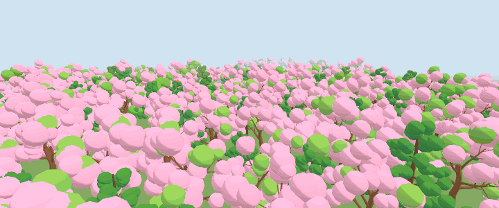
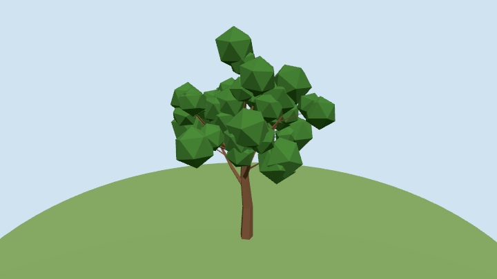
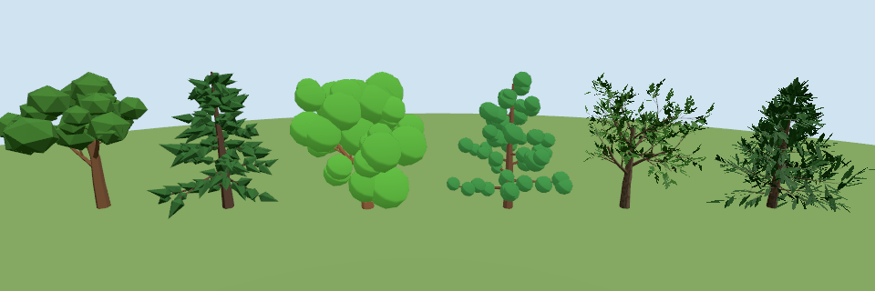
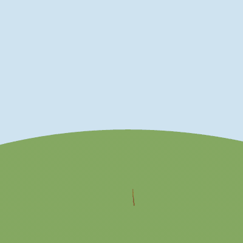
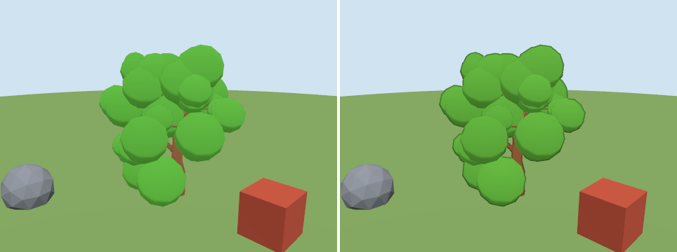
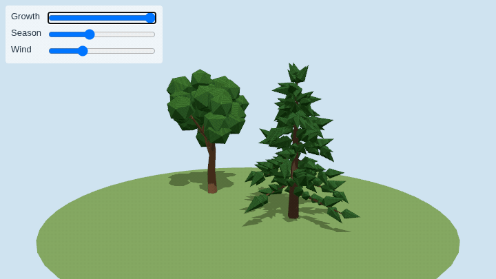
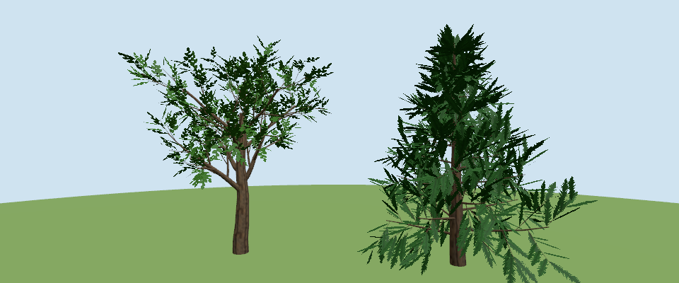
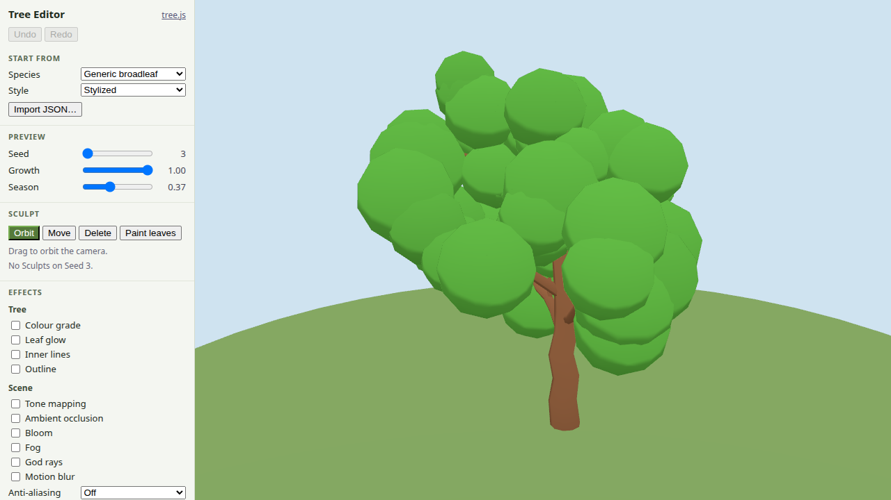
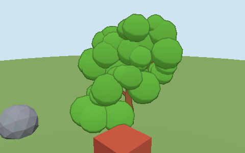
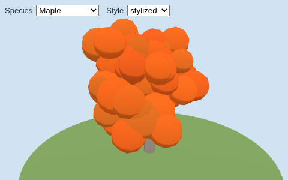

# tree.js



Procedural trees for [three.js](https://threejs.org): one Tree Definition and a Seed grow a unique tree, in a
low-poly, stylized or realistic Style. Trees grow (Growth), change through the year (Season) and sway in the
Wind, all on the GPU through TSL node materials, so animating them never regenerates geometry. Place
thousands at once as an instanced Forest, add opt-in Tree Effects, or design your own trees in the
[Tree Editor](#tree-editor).

- [Install](#install)
- [Quick start](#quick-start)
- [WebGPURenderer is required](#webgpurenderer-is-required)
- [Styles](#styles)
- [Species](#species)
- [Tree Definitions and Seeds](#tree-definitions-and-seeds)
- [Growth and Season](#growth-and-season)
- [Wind](#wind)
- [Forests](#forests)
- [Tree Effects](#tree-effects)
- [React Three Fiber](#react-three-fiber)
- [Without a bundler: import map (CDN)](#without-a-bundler-import-map-cdn)
- [Baked Trees (glTF export)](#baked-trees-gltf-export)
- [Textures](#textures)
- [Tree Editor](#tree-editor)
- [Examples](#examples)

## Install

```sh
npm install @casmo/tree.js three
```

`three` (r187 or newer) is a peer dependency. For the React bindings also install `react` (19) and
`@react-three/fiber` (v9); vanilla three.js apps don't need them.

| Import | What |
| --- | --- |
| `@casmo/tree.js` | `createTree`, `createForest`, Definitions, Wind, Baked Tree export, `loadStyle`, ... |
| `@casmo/tree.js/styles/low-poly` (`stylized`, `realistic`) | a built-in Style: one Tree Definition per Form (a few kB of data) |
| `@casmo/tree.js/species` | the 28 Species (`oak`, `douglasFir`, ...), `loadSpecies`, `SPECIES_NAMES`; JSON files |
| `@casmo/tree.js/effects` | Tree Effects (post-processing) |
| `@casmo/tree.js/react` | `<Tree>`, `<Forest>`, `<Wind>`, `useTreeStyle` for React Three Fiber |

## Quick start



```ts
import * as THREE from 'three/webgpu';
import { createTree } from '@casmo/tree.js';
import lowPoly from '@casmo/tree.js/styles/low-poly';

const renderer = new THREE.WebGPURenderer({ antialias: true });
renderer.setSize(innerWidth, innerHeight);
document.body.appendChild(renderer.domElement);
await renderer.init();

const scene = new THREE.Scene();
scene.add(new THREE.HemisphereLight('#ffffff', '#6a7a4a', 1.5));
const sun = new THREE.DirectionalLight('#ffffff', 2.5);
sun.position.set(5, 8, 3);
scene.add(sun);

const camera = new THREE.PerspectiveCamera(45, innerWidth / innerHeight, 0.1, 100);
camera.position.set(9, 4, 9);
camera.lookAt(0, 2.5, 0);

const tree = createTree(lowPoly.broadleaf, { seed: 42, growth: 1, season: 0.4 });
scene.add(tree);

renderer.setAnimationLoop(() => renderer.render(scene, camera));
```

A `Tree` is a three.js `Group` with three meshes, `tree.wood`, `tree.leaves` and `tree.fruit` (empty
without Fruit; all cast and receive shadows). `tree.dispose()` frees its geometries and materials and removes it from the scene.

## WebGPURenderer is required


*The same scene on WebGPU (left) and on WebGPURenderer's WebGL2 fallback (right).*

Tree materials are TSL node materials, so trees must be drawn by `WebGPURenderer` from `three/webgpu`
(not the classic `WebGLRenderer`). WebGPURenderer uses WebGPU where the browser has it and falls back to
WebGL2 by itself, so you keep WebGL2 support; pass `forceWebGL: true` to try the fallback. Call
`await renderer.init()` before the first render. Drawing a tree with any other renderer throws an
`UnsupportedRendererError` that says so:

```ts
import { assertWebGPURenderer, UnsupportedRendererError } from '@casmo/tree.js';

try {
  assertWebGPURenderer(renderer); // what every tree mesh checks before it is drawn
} catch (error) {
  if (error instanceof UnsupportedRendererError) console.error(error.message);
}
```

The rest of your scene can keep any materials; only the trees need the node renderer.

## Styles



*`low-poly`, `stylized` and `realistic`: a broadleaf and a conifer each.*

A Style is a ready-made look with one Tree Definition per Form (`broadleaf`, `conifer`):

| Style | Look |
| --- | --- |
| `low-poly` | faceted (flat shading), solid colours, clump and needle leaves |
| `stylized` | soft two-tone (toon) shading, round leaf puffs, pink blossom in early spring |
| `realistic` | textured bark (with normal map) and leaf cards |

Each Style is its own small module, so you only download the ones you use. Import one statically, or load
it on demand by name:

```ts
import { createTree, extendDefinition, loadStyle } from '@casmo/tree.js';
import stylized from '@casmo/tree.js/styles/stylized';

const oak = createTree(stylized.broadleaf, { seed: 1 });
const pine = createTree(stylized.conifer, { seed: 2 });

const realistic = await loadStyle('realistic'); // dynamic import of '@casmo/tree.js/styles/realistic'
const birch = createTree(realistic.broadleaf, { seed: 3 });
await birch.ready; // resolves once its textures have loaded (instantly for trees without textures)

// A Style's Definitions are plain data: start from one and change what you like.
const tallPine = createTree(extendDefinition(stylized.conifer, { trunk: { length: 9 } }), { seed: 2 });
scene.add(oak, pine, birch, tallPine);
```

## Species

[](docs/species/README.md)

*Every Species in `low-poly`, `stylized` and `realistic`; the [Species gallery](docs/species/README.md) has larger
images (with Fruit or in autumn), a code example and the JSON of each.*

28 real trees ship with the library, each described once by its shape (Stems, Crown Shape), Leaf Type, Bark
Type, Fruit, colours and Season Profile, and drawn in any Style:

```ts
import { createTree, loadStyle } from '@casmo/tree.js';
import { oak } from '@casmo/tree.js/species';
scene.add(createTree((await loadStyle('realistic')).apply(oak), { seed: 42 }));
```

- **Broadleaf**: `almond`, `apple`, `ash`, `beech`, `birch`, `cherry`, `chestnut`, `elm`, `hickory`, `mahogany`, `maple`, `oak`, `olive`, `peach`, `pear`, `plum`, `redOak`, `teak`, `walnut`, `whiteOak`
- **Conifer**: `cedar`, `douglasFir`, `hemlock`, `juniper`, `pine`, `redwood`, `sequoia`, `spruce`

`style.apply(species, overrides?)` returns an ordinary, complete Tree Definition, so it works everywhere a
Definition does (`createTree`, `createForest`, Baked Trees, the Tree Editor). Each Species is its own module:
importing two doesn't bundle the other 26.

```ts
import { createForest, createTree } from '@casmo/tree.js';
import { apple, douglasFir, loadSpecies, SPECIES_NAMES, type SpeciesName } from '@casmo/tree.js/species';
import lowPoly from '@casmo/tree.js/styles/low-poly';
import stylized from '@casmo/tree.js/styles/stylized';

const tallFir = createTree(stylized.apply(douglasFir, { trunk: { length: 14 } }), { seed: 3 });
const orchard = createForest(lowPoly.apply(apple), [
  { id: 'a', position: [0, 0, 0] },
  { id: 'b', position: [5, 0, 1] },
]);

// At runtime, e.g. from level data: a dynamic import per Species (rejects unknown ids).
const name: SpeciesName = SPECIES_NAMES.includes('birch') ? 'birch' : 'oak';
const birch = createTree(lowPoly.apply(await loadSpecies(name)), { season: 0.6 });
scene.add(tallFir, orchard, birch);
```

`SPECIES_BY_NAME` maps every id to its Species (for a picker that lists them all; it bundles all 28).
Without a bundler, every Species is also a plain JSON file: `@casmo/tree.js/species/<id>.json` (for example
`https://cdn.jsdelivr.net/npm/@casmo/tree.js/dist/species/douglas-fir.json`). In React:
`<Tree species={oak} style={lowPoly} seed={7} />`. Try them all in [`examples/species`](examples/species/main.ts).

## Tree Definitions and Seeds


*The birch Definition below with Seeds 1 to 5.*

A Tree Definition is plain JSON (what the Tree Editor exports): trunk, branch levels, leaves, materials,
the Season Profile, the Wind response, Seed variation ranges and Sculpts. Every field is documented in
[`src/definition/types.ts`](src/definition/types.ts); missing fields get defaults, so a Definition can be
small. The Seed picks one individual tree within the Definition's ranges: the same Definition and Seed
always give exactly the same tree.

```ts
import { createTree, fetchDefinition, parseDefinition, TreeDefinitionError, type TreeDefinitionInput } from '@casmo/tree.js';

const birch: TreeDefinitionInput = {
  schemaVersion: 3,
  trunk: { length: 6, radius: 0.15 },
  branches: [
    { count: 6, angle: 45 },
    { count: 4, length: 0.5 },
  ],
  leaves: { count: 6, shape: 'card', size: 0.3 },
  materials: { bark: { color: '#d8d2c4' } },
};
const trees = [1, 2, 3].map((seed) => createTree(birch, { seed })); // three different birches

const fromEditor = await fetchDefinition('/trees/my-oak.json'); // a Tree Editor export
const tree = createTree(fromEditor, { seed: 7 });

try {
  parseDefinition('{"schemaVersion": 3, "trunk": {"length": -1}}');
} catch (error) {
  if (error instanceof TreeDefinitionError) console.warn(error.field, error.message); // 'trunk.length'
}
```

Each branch level can carry a **Crown Shape**: optional `lengthProfile` and `angleProfile` keyframe
curves over where a branch sits on its parent (0 = base .. 1 = tip) that multiply the level's `length`
and `angle` (linear between keyframes, flat = 1 when absent). A cone is
`lengthProfile: [{ t: 0.2, value: 1 }, { t: 1, value: 0.1 }]` on the first level; a ball, column, vase
or flat top are other curves.

A tree can grow several **Stems** from the ground: `trunk: { stems: 3, spread: 20 }` stands three full
trunks (each with the whole branch structure) in a small ring, leaning out about 20° from vertical (the
Seed varies each lean). `trunk.gravity` (−1..1) bends only the leader, the top third of each Stem: −1 makes
it nod like a hemlock's. Absent, a tree has one upright Stem without gravity.

A **Root Flare** widens each Stem towards the ground: `trunk.flare` (0..1) eases the bottom ~12% of the
Stem's length out to (1 + 0.8 × `flare`) × the trunk radius at the base, so the trunk grows into the soil
instead of standing on it like a post. It is geometry only: branches, leaves, Fruit, Growth, Wind and Sculpts
stay exactly where they were. The optional `flareSections` (integer ≥ 1) is how many extra rings the flare
gets, set by `Style.apply` (2 in low-poly, 3 in the others; absent = 3). Absent `flare` means none. Every
trunk's base ring sits a tenth of its radius below the ground (also without flare), so no seam shows on
uneven terrain:

```ts
import { createTree, extendDefinition, type TreeDefinitionInput } from '@casmo/tree.js';

const oak: TreeDefinitionInput = { schemaVersion: 3, trunk: { length: 5, radius: 0.35, flare: 0.8 } };
const flared = createTree(oak, { seed: 3 });
const slender = extendDefinition(oak, { trunk: { flare: 0.15 } }); // a hint of a flare, same crown
```

**Roots** are an optional `roots` block: a few Roots grow from the Root Flare of every Stem, run outward
and down, taper to a point and vanish below the ground. `count` is Roots per Stem (0..12), `length` a
fraction of the Stem's length (`lengthVariation` is the Seed's ± range), `radius` a fraction of the trunk's
base radius, `angle` how steeply they dive (degrees below horizontal, 0..60) and `bend` how much they wander
sideways. A partial block is filled from `DEFAULT_ROOTS` (5 Roots, length 0.25, radius 0.35, angle 12°);
absent means none. A single Stem's Roots spread all round it; with several Stems each Stem's Roots cover
only the half-circle facing away from the others. Roots follow the Sculpts of their Stem: a deleted Stem has
none, a turned Stem keeps them on the ground at its base, a scaled one scales them with its length, and
another Stem's Roots never change. The optional `sides` and `sections` are their polygon detail, set by `Style.apply`
(realistic 8 / 6, stylized 6 / 4, low-poly 3 / 2). Roots are part of the wood mesh, grow with the trunk from
Growth 0, never sway in the Wind and cannot be Sculpted; adding or removing them leaves the branches,
leaves and Fruit exactly as they were. The tree data lists them in `skeleton.roots` (branch-like entries
with paths `0/r0`, `0/r1`, ... and their Stem as `parent`) with their Growth windows in `growth.roots`:

```ts
import { createTree, DEFAULT_ROOTS, type SkeletonBranch } from '@casmo/tree.js';

const rooted = createTree({ schemaVersion: 3, trunk: { flare: 0.6 }, roots: { count: 7, angle: 10 } }, { seed: 3 });
const roots: SkeletonBranch[] = rooted.data.skeleton.roots; // 7 Roots: '0/r0' .. '0/r6', parent '0'
const tips = roots.map((root) => root.points.at(-1)!.position); // all below the ground (y < 0)
const windows = rooted.data.growth.roots; // { start: 0, end: 0 }: there from Growth 0, like the trunk
const defaults = DEFAULT_ROOTS; // { count: 5, length: 0.25, lengthVariation: 0.3, radius: 0.35, angle: 12, bend: 0.3 }
```

**Fruit** is an optional `fruit` block: `type` (`'round'`, `'pear'`, `'nut'`, `'cone'` or `'berry'`),
`count` per outermost twig, `size`, `sizeVariation` and `hang` (0 = sits on the twig .. 1 = hangs
straight down). A fractional `count` is a chance per twig: `0.3` puts one Fruit on about 30% of the
twigs, `1.5` one on every twig and a second on about half (the Seed picks which). The optional `sides`
(3..16) is its polygon detail, set by `Style.apply`: low-poly draws a few flat facets (5 or fewer sides
also coarsen the profile), stylized and realistic smoother shapes; absent = each Fruit Type's own detail.
It is drawn in its own mesh in the Definition's shading, only on a fully grown tree, and sways with its twig:

```ts
import { createTree } from '@casmo/tree.js';

const apple = createTree({
  schemaVersion: 3,
  fruit: { type: 'round', count: 2, size: 0.1, hang: 0.8 },
  season: {
    fruit: [{ t: 0.1, value: 0 }, { t: 0.35, value: 1 }, { t: 0.6, value: 1 }, { t: 0.7, value: 0 }],
    fruitColor: [{ t: 0.25, value: '#7cb342' }, { t: 0.5, value: '#c62828' }],
  },
});
```

Older Definitions (lower `schemaVersion`) are migrated when parsed (a v2 `form: 'conifer'` becomes the
equivalent cone `lengthProfile`, so the tree stays identical). `extendDefinition(base, patch)`
deep-merges a patch (arrays replace) and validates the result. Sculpts (hand edits made in the Tree Editor)
belong to one Seed: they only change the tree of that Seed.

## Growth and Season



**Growth** goes from 0 (sapling) to 1 (fully grown); branches sprout after their parent and leaves come
last. **Season** goes from 0 (first day of spring) to 1 (last day of winter) and sets leaf colour, leaf
coverage and blossom from the Definition's Season Profile (values outside 0..1 wrap around the year).
Both only write a uniform, so they are cheap to animate every frame:

```ts
import { createTree, SEASON_PROFILES } from '@casmo/tree.js';

const tree = createTree({ schemaVersion: 3, season: SEASON_PROFILES.deciduous }, { seed: 5, growth: 0, season: 0 });
scene.add(tree);

renderer.setAnimationLoop((time) => {
  tree.growth = Math.min(1, time / 10_000); // grows in 10 s
  tree.season = time / 60_000; // a year per minute
  renderer.render(scene, camera);
});
```

Each tree's Seed shifts its timing a little (`variation.growth`, `variation.season`), so trees of one
Definition don't change in lockstep. `SEASON_PROFILES.deciduous` and `.evergreen` are ready-made Season
Profiles; write your own as keyframes in the Definition's `season` (`leafColor`, `leafCoverage`,
`blossom`, `blossomColor`, and for Fruit `fruit` (amount: each Fruit shows above its own rank and swells
with the amount; 1 all year when absent) and `fruitColor` (ripening)).

## Wind


Wind has a scene-wide part (direction and strength) and a per-tree part (the Definition's `wind`
response: how much the trunk, branches and leaves move). Every tree sways with the shared `sceneWind`
unless you give it another `Wind`. All of it is uniforms, so changing the wind is free:

```ts
import { createTree, sceneWind, Wind } from '@casmo/tree.js';

sceneWind.set({ direction: [1, 0, -0.4], strength: 0.6 }); // 0 = calm (default), 1 = strong
const swaying = createTree({ schemaVersion: 3, wind: { trunk: 0.4, branches: 0.8, leaves: 1 } }, { seed: 1 });

// A separate wind, e.g. for a sheltered courtyard:
const breeze = new Wind({ direction: [0, 0, 1], strength: 0.2 });
const sheltered = createTree({ schemaVersion: 3 }, { seed: 2, wind: breeze });

swaying.windResponse.set({ leaves: 0.5 }); // change one tree's response live
sceneWind.time = 1.5; // pin the wind clock (seconds), e.g. for screenshots; null = the renderer's clock
scene.add(swaying, sheltered);
```

A swaying tree needs a render loop (`renderer.setAnimationLoop`).

## Forests


*400 trees from 4 Variants, with a per-tree Season (autumn towards the right).*

A Forest draws many trees of one Definition from a few Variants (Seeds), each instanced, so 1,000 trees
cost two draw calls per Variant (three with Fruit: `variant.fruit` is a third instanced mesh, null without
Fruit). Every tree still looks its own: its Variant, rotation, Growth delay,
Season shift and wind phase come from a hash of the forest seed and the tree's id (or position), so adding
or removing trees never changes the others.

```ts
import { Raycaster } from 'three/webgpu';
import { createForest, type ForestPlacement } from '@casmo/tree.js';
import lowPoly from '@casmo/tree.js/styles/low-poly';

const placements: ForestPlacement[] = [];
for (let i = 0; i < 400; i++) {
  placements.push({ id: i, position: [(i % 20) * 4, 0, Math.floor(i / 20) * 4], rotation: i * 2.4, scale: 0.8 + (i % 5) * 0.1 });
}
const forest = createForest(lowPoly.conifer, placements, { variants: 4, seed: 1, growth: 1, season: 0.3 });
scene.add(forest);

forest.season = 0.65; // every tree, each with its own shift
forest.addTree({ id: 'new', position: [-4, 0, 0] });
forest.removeTree(17); // by id, key or ForestTree
const tree = forest.get('new');
if (tree) tree.growth = 0.3; // per-tree Growth and Season

// Which tree did the user click?
const raycaster = new Raycaster(); // set from the pointer: raycaster.setFromCamera(pointer, camera)
const [hit] = raycaster.intersectObject(forest);
if (hit) console.log(forest.treeAt(hit)?.key);
```

`forest.dispose()` frees everything. `forest.ready` resolves once its textures have loaded.

## Tree Effects



*Without (left) and with (right) the `stylized` suggestion: only the tree changes, the rock and crate don't.*

`@casmo/tree.js/effects` has opt-in post-processing (TSL nodes for three.js `RenderPipeline`) that only
changes the pixels of trees: an **outline**, a **leaf glow** and **colour grading**. Trees look fine
without them. Every tree.js material (wood, leaves and Fruit, of Trees and Forests) is found automatically (a per-object tree mask in
an MRT output), so no tree has to be registered.

```ts
import { createTreeEffects } from '@casmo/tree.js/effects';

const effects = createTreeEffects(renderer, scene, camera, { effects: 'stylized' }); // the Style's suggested combination
renderer.setAnimationLoop(() => effects.render()); // instead of renderer.render(scene, camera)
effects.set({ outline: { color: '#203018', thickness: 2 }, grade: { saturation: 1.1 } }); // or null = none
```

Pass `selection: [tree]` to outline only some trees. In your own pipeline, the effects are nodes that
compose with your other effects:

```ts
import * as THREE from 'three/webgpu';
import { float, screenUV, vec4 } from 'three/tsl';
import { applyTreeEffects, SUGGESTED_TREE_EFFECTS, treeEffectsPass } from '@casmo/tree.js/effects';

const pipeline = new THREE.RenderPipeline(renderer);
const input = treeEffectsPass(scene, camera); // { pass, color, mask }
const trees = applyTreeEffects(input, SUGGESTED_TREE_EFFECTS['low-poly']); // or treeOutline / leafGlow / treeColorGrade
const vignette = float(1).sub(screenUV.sub(0.5).length().mul(0.9).pow(2)); // your own effect on top
pipeline.outputNode = vec4(trees.rgb.mul(vignette), 1);
renderer.setAnimationLoop(() => pipeline.render());
```

To add the tree mask to a scene pass you already have, merge `treeMaskMRT()` into its MRT and read the
mask with `scenePass.getTextureNode(TREE_MASK)`.

## React Three Fiber


`@casmo/tree.js/react` has `<Tree>`, `<Forest>`, `<Wind>` and `useTreeStyle`. Trees use TSL node
materials, so give `<Canvas>` a `WebGPURenderer` (it falls back to WebGL2 by itself). R3F v9 takes an
async `gl` factory, which must `await renderer.init()` before it returns:

```tsx
import * as THREE from 'three/webgpu';
import { Suspense } from 'react';
import { createRoot } from 'react-dom/client';
import { Canvas } from '@react-three/fiber';
import { Forest, Tree, Wind, useTreeStyle } from '@casmo/tree.js/react';

function Trees() {
  const lowPoly = useTreeStyle('low-poly'); // dynamic import; suspends while it loads
  return (
    <>
      <Tree style={lowPoly} form="broadleaf" seed={1} growth={0.8} season={0.4} />
      <Tree style="low-poly" form="conifer" seed={2} position={[3, 0, 0]} castShadow={false} />
      <Tree definition={{ schemaVersion: 3, leaves: { count: 4 } }} seed={7} position={[-3, 0, 0]} />
      <Forest
        style={lowPoly}
        form="conifer"
        placements={[
          { id: 'a', position: [0, 0, -8] },
          { id: 'b', position: [4, 0, -9], growth: 0.5 },
        ]}
      />
    </>
  );
}

function App() {
  return (
    <Canvas
      shadows="percentage"
      camera={{ position: [9, 4, 9] }}
      gl={async (props) => {
        const renderer = new THREE.WebGPURenderer(props as THREE.WebGPURendererParameters);
        await renderer.init();
        return renderer;
      }}
    >
      <hemisphereLight args={['#ffffff', '#6a7a4a', 1.5]} />
      <directionalLight position={[5, 8, 3]} intensity={2.5} castShadow />
      <Wind direction={[1, 0, 0]} strength={0.5} />
      <Suspense fallback={null}>
        <Trees />
      </Suspense>
    </Canvas>
  );
}

createRoot(document.getElementById('root')!).render(<App />);
```

- `growth`, `season`, `wind`, `castShadow`/`receiveShadow` and `<Wind>` props only update uniforms or flags on the same tree
  (`tree.wind = otherWind` does the same outside React).
- A new `seed`, `definition` (compared by value) or `style`/`form` regenerates the tree. Trees are disposed of on unmount.
- `style` also takes a Style name (`<Tree style="low-poly" />`), which suspends like `useTreeStyle`. The `ref` is the tree.js `Tree` (or `Forest`) object.
- `<Forest>` diffs its `placements` by id: changing the array plants and cuts trees without touching the others; per-tree `growth`/`season` override the forest's.
- Use `shadows="percentage"` (plain `shadows` asks for a shadow type WebGPURenderer no longer has).

## Without a bundler: import map (CDN)



*[`examples/cdn`](examples/cdn/index.html): Growth, Season and Wind sliders, no build step.*

The package is plain ES modules, so it runs straight from a CDN with an
[import map](https://developer.mozilla.org/docs/Web/HTML/Element/script/type/importmap). Map `three`'s
entry points and the library (with a trailing-slash entry for its subpaths):

```html
<script type="importmap">
  {
    "imports": {
      "three": "https://cdn.jsdelivr.net/npm/three@0.187.0/build/three.webgpu.js",
      "three/webgpu": "https://cdn.jsdelivr.net/npm/three@0.187.0/build/three.webgpu.js",
      "three/tsl": "https://cdn.jsdelivr.net/npm/three@0.187.0/build/three.tsl.js",
      "three/addons/": "https://cdn.jsdelivr.net/npm/three@0.187.0/examples/jsm/",
      "@casmo/tree.js": "https://cdn.jsdelivr.net/npm/@casmo/tree.js/dist/index.js",
      "@casmo/tree.js/": "https://cdn.jsdelivr.net/npm/@casmo/tree.js/dist/"
    }
  }
</script>
<script type="module">
  import * as THREE from 'three/webgpu';
  import { createTree, loadStyle } from '@casmo/tree.js';
  import { createTreeEffects } from '@casmo/tree.js/effects.js'; // subpaths: dist/<name>.js

  const lowPoly = await loadStyle('low-poly'); // or import '@casmo/tree.js/styles/low-poly.js'
  const tree = createTree(lowPoly.broadleaf, { seed: 3 });
  // ...the same scene setup as in the quick start
</script>
```

Styles and the realistic textures load relative to the library's URL, so they come from the CDN too. See
[`examples/cdn/index.html`](examples/cdn/index.html) for a complete page (with Growth, Season and Wind sliders).

## Baked Trees (glTF export)


*A `.glb` from `exportBakedTree(tree, { season: 0.6 })`, loaded back with three.js' `GLTFLoader`.*

A Baked Tree is a static copy of one tree at a fixed Growth and Season (no Growth, Season or Wind left), with
classic `MeshStandardMaterial`s, for other engines or tools. It has meshes `wood`, `leaves` and, when Fruit
shows at the baked Growth and Season, `fruit`:

```ts
import { bakeTree, createTree, disposeBakedTree, exportBakedTree } from '@casmo/tree.js';

const tree = createTree({ schemaVersion: 3 }, { seed: 4 });
const glb = await exportBakedTree(tree, { growth: 1, season: 0.6 }); // ArrayBuffer (.glb); binary: false = glTF JSON
const url = URL.createObjectURL(new Blob([glb], { type: 'model/gltf-binary' }));

const baked = bakeTree(tree, { season: 0.6 }); // a THREE.Group, e.g. for your own exporter
// ...export it, then free its geometries and materials:
disposeBakedTree(baked);
```

## Textures



Definitions with textures (the realistic Style, or your own `materials.bark.map` / `materials.leaf.map`
URLs) load them relative to the package's `dist/textures/` by default. To serve them yourself, copy that
folder and point tree.js at it, app-wide or per tree. `realistic.apply` picks a leaf card per Leaf Type
(`realistic/leaf.png`, `leaf-lobed.png`, `leaf-palmate.png`, `leaf-compound.png`, `needles.png`,
`scale.png`) and a colour + normal pair per Bark Type (`realistic/bark.png` for furrowed, `bark-smooth.png`,
`bark-papery.png`, `bark-fibrous.png`, `bark-plated.png`, each with its `-normal.png`); all are made by
`scripts/generate-textures.mjs` (MIT, reproducible):

```ts
import { createTree, setTextureOptions } from '@casmo/tree.js';
import realistic from '@casmo/tree.js/styles/realistic';

setTextureOptions({ basePath: 'https://cdn.example.com/tree-textures/' });
const tree = createTree(realistic.conifer, {
  seed: 1,
  textures: { urls: { 'realistic/needles.png': '/my-needles.png' } }, // per-tree overrides win
});
await tree.ready;
```

## Tree Editor



The Tree Editor is a web app for designing Tree Definitions: start from a Style, change every parameter with
a live preview (Seed, Growth, Season, Wind, Tree Effects), sculpt single branches and leaf areas of one Seed
(move, delete, paint leaves), undo/redo, and export the Definition as JSON for
`createTree(definition)` (or a Baked Tree as `.glb`). It is published on GitHub Pages
([casmo.github.io/tree.js](https://casmo.github.io/tree.js/)); run it locally with `npm run dev:editor`.

## Examples

| Example | Run | What | |
| --- | --- | --- | --- |
| [`examples/vanilla`](examples/vanilla/main.ts) | `/examples/vanilla/` | one tree in plain three.js; `?style=low-poly&form=conifer&seed=2&growth=0.6&season=0.7&wind=0.5` |  |
| [`examples/cdn`](examples/cdn/index.html) | `/examples/cdn/` | no bundler: a single HTML page with an import map |  |
| [`examples/react`](examples/react/main.tsx) | `/examples/react/` | React Three Fiber: `<Tree>`, `<Wind>`, `useTreeStyle`; `?scene=forest` for `<Forest>` |  |
| [`examples/forest`](examples/forest/main.ts) | `/examples/forest/` | a 400-tree Forest; `?trees=&variants=&style=&season=` |  |
| [`examples/effects`](examples/effects/main.ts) | `/examples/effects/` | Tree Effects per Style; `?style=stylized&effects=outline` |  |
| [`examples/species`](examples/species/main.ts) | `/examples/species/` | a Species x Style picker over the whole collection; `?species=douglas-fir&style=realistic` |  |

```sh
npm install
npm run dev              # then open http://localhost:5173/examples/vanilla/ (or any example above)
npm run build:examples   # production build of the bundled examples -> examples/dist
```

The examples import the library by its package name (`@casmo/tree.js`), exactly like an app would; in this
repository that name resolves to the sources. The CDN example needs no build at all: copy
`examples/cdn/index.html` anywhere and open it over http(s). (The dev server rewrites its imports to the
sources too; the e2e test serves it unmodified, with the import map answered by the built `dist/`.)

## Development

`npm test` (Vitest), `npm run typecheck`, `npm run lint`, `npm run build` (library -> `dist/`),
`npm run test:e2e` (Playwright; run `npm run build` and `npm run build:examples` first, as CI does).
The Species gallery (`docs/species/`: images, contact sheet and page) is regenerated by `npm run gallery`
(Playwright, the e2e renderer; `npm run gallery -- oak birch` redoes only those Species).
The README's screenshots and GIFs (`docs/images/`) are rendered by `npm run readme-media`
(Playwright + ffmpeg; run `npm run build` first; `npm run readme-media -- wind hero` redoes only those).
Design decisions live in [`docs/adr`](docs/adr), the vocabulary in [`GLOSSARY.md`](GLOSSARY.md).

## License

MIT
