# tree.js


Procedural trees for [three.js](https://threejs.org): one Tree Definition and a Seed grow a unique tree, in a
low-poly, stylized or realistic Style. Trees grow (Growth), change through the year (Season) and sway in the
Wind, all on the GPU through TSL node materials, so animating them never regenerates geometry. Place
thousands at once as an instanced Forest, add opt-in Tree Effects, or design your own trees in the
[Tree Editor](#tree-editor).

- [Install](#install)
- [Quick start](#quick-start)
- [WebGPURenderer is required](#webgpurenderer-is-required)
- [Styles](#styles)
- [Species](#species)
- [Tree Definitions and Seeds](#tree-definitions-and-seeds)
- [Growth and Season](#growth-and-season)
- [Wind](#wind)
- [Forests](#forests)
- [Material Features](#material-features)
- [Tree Shader Hook](#tree-shader-hook)
- [Tree Effects](#tree-effects)
- [React Three Fiber](#react-three-fiber)
- [Without a bundler: import map (CDN)](#without-a-bundler-import-map-cdn)
- [Baked Trees (glTF export)](#baked-trees-gltf-export)
- [Using a Baked Tree in other engines](#using-a-baked-tree-in-other-engines)
- [Textures](#textures)
- [Tree Editor](#tree-editor)
- [Examples](#examples)

## Install

```sh
npm install @casmo/tree.js three
```

`three` (r187 or newer) is a peer dependency. For the React bindings also install `react` (19) and
`@react-three/fiber` (v9); vanilla three.js apps don't need them.

| Import | What |
| --- | --- |
| `@casmo/tree.js` | `createTree`, `createForest`, Definitions, Wind, Baked Tree export, `loadStyle`, ... |
| `@casmo/tree.js/styles/low-poly` (`stylized`, `realistic`) | a built-in Style: one Tree Definition per Form (a few kB of data) |
| `@casmo/tree.js/species` | the 28 Species (`oak`, `douglasFir`, ...), `loadSpecies`, `SPECIES_NAMES`; JSON files |
| `@casmo/tree.js/effects` | Tree Effects (post-processing) |
| `@casmo/tree.js/scene` | Scene Pipeline: the Style's suggested Tree Effects and Scene Effects (tone mapping, SMAA/FXAA, fog, ...) in one opt-in pipeline |
| `@casmo/tree.js/weather` | ready-made weather Tree Shader Hooks: [Snow Cover](#snow-cover), [Wetness](#wetness) |
| `@casmo/tree.js/react` | `<Tree>`, `<Forest>`, `<Wind>`, `useTreeStyle`, `<ScenePipeline>` for React Three Fiber |

## Quick start


```ts
import * as THREE from 'three/webgpu';
import { createTree } from '@casmo/tree.js';
import lowPoly from '@casmo/tree.js/styles/low-poly';

const renderer = new THREE.WebGPURenderer({ antialias: true });
renderer.setSize(innerWidth, innerHeight);
document.body.appendChild(renderer.domElement);
await renderer.init();

const scene = new THREE.Scene();
scene.add(new THREE.HemisphereLight('#ffffff', '#6a7a4a', 1.5));
const sun = new THREE.DirectionalLight('#ffffff', 2.5);
sun.position.set(5, 8, 3);
scene.add(sun);

const camera = new THREE.PerspectiveCamera(45, innerWidth / innerHeight, 0.1, 100);
camera.position.set(9, 4, 9);
camera.lookAt(0, 2.5, 0);

const tree = createTree(lowPoly.broadleaf, { seed: 42, growth: 1, season: 0.4 });
scene.add(tree);

renderer.setAnimationLoop(() => renderer.render(scene, camera));
```

A `Tree` is a three.js `Group` with three meshes, `tree.wood`, `tree.leaves` and `tree.fruit` (empty
without Fruit; all cast and receive shadows). `tree.dispose()` frees its geometries and materials and removes it from the scene.

## WebGPURenderer is required

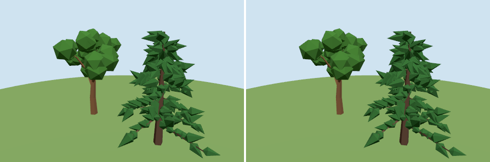

*The same scene on WebGPU (left) and on WebGPURenderer's WebGL2 fallback (right).*

Tree materials are TSL node materials, so trees must be drawn by `WebGPURenderer` from `three/webgpu`
(not the classic `WebGLRenderer`). WebGPURenderer uses WebGPU where the browser has it and falls back to
WebGL2 by itself, so you keep WebGL2 support; pass `forceWebGL: true` to try the fallback. Call
`await renderer.init()` before the first render. Drawing a tree with any other renderer throws an
`UnsupportedRendererError` that says so:

```ts
import { assertWebGPURenderer, UnsupportedRendererError } from '@casmo/tree.js';

try {
  assertWebGPURenderer(renderer); // what every tree mesh checks before it is drawn
} catch (error) {
  if (error instanceof UnsupportedRendererError) console.error(error.message);
}
```

The rest of your scene can keep any materials; only the trees need the node renderer.

## Styles


*`low-poly`, `stylized` and `realistic`: a broadleaf and a conifer each.*

A Style is a ready-made look with one Tree Definition per Form (`broadleaf`, `conifer`):

| Style | Look |
| --- | --- |
| `low-poly` | faceted (flat shading), solid colours, clump and needle leaves |
| `stylized` | soft two-tone (toon) shading, round leaf puffs, pink blossom in early spring |
| `realistic` | textured bark (with normal map) and leaf cards |

Each Style is its own small module, so you only download the ones you use. Import one statically, or load
it on demand by name:

```ts
import { createTree, extendDefinition, loadStyle } from '@casmo/tree.js';
import stylized from '@casmo/tree.js/styles/stylized';

const oak = createTree(stylized.broadleaf, { seed: 1 });
const pine = createTree(stylized.conifer, { seed: 2 });

const realistic = await loadStyle('realistic'); // dynamic import of '@casmo/tree.js/styles/realistic'
const birch = createTree(realistic.broadleaf, { seed: 3 });
await birch.ready; // resolves once its textures have loaded (instantly for trees without textures)

// A Style's Definitions are plain data: start from one and change what you like.
const tallPine = createTree(extendDefinition(stylized.conifer, { trunk: { length: 9 } }), { seed: 2 });
scene.add(oak, pine, birch, tallPine);
```

## Species

[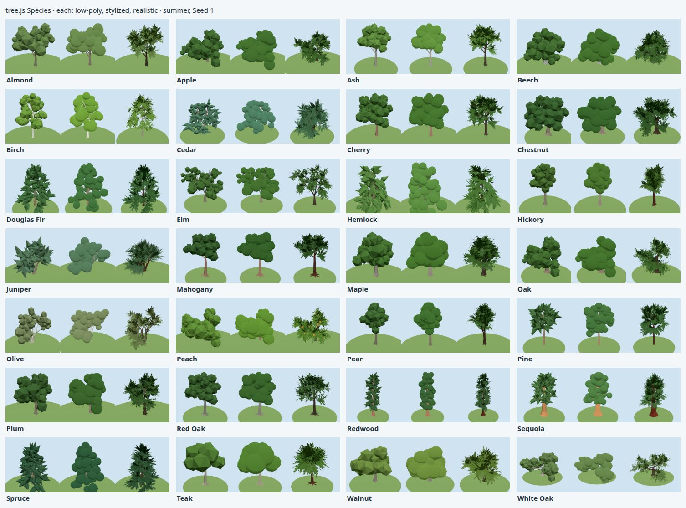](docs/species/README.md)

*Every Species in `low-poly`, `stylized` and `realistic`; the [Species gallery](docs/species/README.md) has larger
images (with Fruit or in autumn), a code example and the JSON of each.*

28 real trees ship with the library, each described once by its shape (Stems, Crown Shape), Leaf Type, Bark
Type, Fruit, colours and Season Profile, and drawn in any Style:

```ts
import { createTree, loadStyle } from '@casmo/tree.js';
import { oak } from '@casmo/tree.js/species';
scene.add(createTree((await loadStyle('realistic')).apply(oak), { seed: 42 }));
```

- **Broadleaf**: `almond`, `apple`, `ash`, `beech`, `birch`, `cherry`, `chestnut`, `elm`, `hickory`, `mahogany`, `maple`, `oak`, `olive`, `peach`, `pear`, `plum`, `redOak`, `teak`, `walnut`, `whiteOak`
- **Conifer**: `cedar`, `douglasFir`, `hemlock`, `juniper`, `pine`, `redwood`, `sequoia`, `spruce`

`style.apply(species, overrides?)` returns an ordinary, complete Tree Definition, so it works everywhere a
Definition does (`createTree`, `createForest`, Baked Trees, the Tree Editor). Each Species is its own module:
importing two doesn't bundle the other 26.

```ts
import { createForest, createTree } from '@casmo/tree.js';
import { apple, douglasFir, loadSpecies, SPECIES_NAMES, type SpeciesName } from '@casmo/tree.js/species';
import lowPoly from '@casmo/tree.js/styles/low-poly';
import stylized from '@casmo/tree.js/styles/stylized';

const tallFir = createTree(stylized.apply(douglasFir, { trunk: { length: 14 } }), { seed: 3 });
const orchard = createForest(lowPoly.apply(apple), [
  { id: 'a', position: [0, 0, 0] },
  { id: 'b', position: [5, 0, 1] },
]);

// At runtime, e.g. from level data: a dynamic import per Species (rejects unknown ids).
const name: SpeciesName = SPECIES_NAMES.includes('birch') ? 'birch' : 'oak';
const birch = createTree(lowPoly.apply(await loadSpecies(name)), { season: 0.6 });
scene.add(tallFir, orchard, birch);
```

`SPECIES_BY_NAME` maps every id to its Species (for a picker that lists them all; it bundles all 28).
Without a bundler, every Species is also a plain JSON file: `@casmo/tree.js/species/<id>.json` (for example
`https://cdn.jsdelivr.net/npm/@casmo/tree.js/dist/species/douglas-fir.json`). In React:
`<Tree species={oak} style={lowPoly} seed={7} />`. Try them all in [`examples/species`](examples/species/main.ts).

## Tree Definitions and Seeds

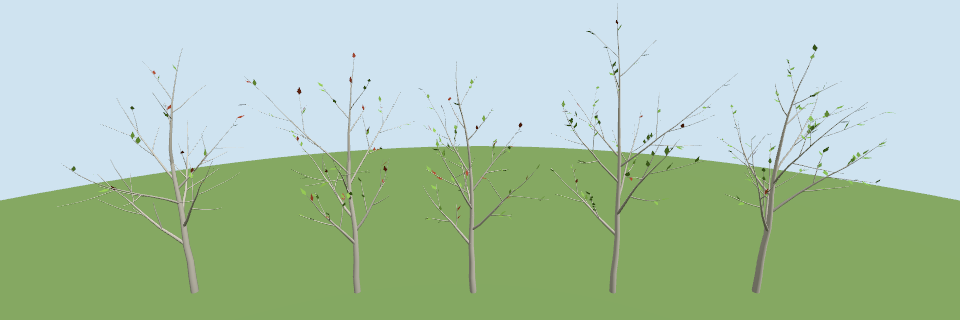

*The birch Definition below with Seeds 1 to 5.*

A Tree Definition is plain JSON (what the Tree Editor exports): trunk, branch levels, leaves, materials,
the Season Profile, the Wind response, Seed variation ranges and Sculpts. Every field is documented in
[`src/definition/types.ts`](src/definition/types.ts); missing fields get defaults, so a Definition can be
small. The Seed picks one individual tree within the Definition's ranges: the same Definition and Seed
always give exactly the same tree.

```ts
import { createTree, fetchDefinition, parseDefinition, TreeDefinitionError, type TreeDefinitionInput } from '@casmo/tree.js';

const birch: TreeDefinitionInput = {
  schemaVersion: 3,
  trunk: { length: 6, radius: 0.15 },
  branches: [
    { count: 6, angle: 45 },
    { count: 4, length: 0.5 },
  ],
  leaves: { count: 6, shape: 'card', size: 0.3 },
  materials: { bark: { color: '#d8d2c4' } },
};
const trees = [1, 2, 3].map((seed) => createTree(birch, { seed })); // three different birches

const fromEditor = await fetchDefinition('/trees/my-oak.json'); // a Tree Editor export
const tree = createTree(fromEditor, { seed: 7 });

try {
  parseDefinition('{"schemaVersion": 3, "trunk": {"length": -1}}');
} catch (error) {
  if (error instanceof TreeDefinitionError) console.warn(error.field, error.message); // 'trunk.length'
}
```

Each branch level can carry a **Crown Shape**: optional `lengthProfile` and `angleProfile` keyframe
curves over where a branch sits on its parent (0 = base .. 1 = tip) that multiply the level's `length`
and `angle` (linear between keyframes, flat = 1 when absent). A cone is
`lengthProfile: [{ t: 0.2, value: 1 }, { t: 1, value: 0.1 }]` on the first level; a ball, column, vase
or flat top are other curves.

A tree can grow several **Stems** from the ground: `trunk: { stems: 3, spread: 20 }` stands three full
trunks (each with the whole branch structure) in a small ring, leaning out about 20° from vertical (the
Seed varies each lean). `trunk.gravity` (−1..1) bends only the leader, the top third of each Stem: −1 makes
it nod like a hemlock's. Absent, a tree has one upright Stem without gravity.

A **Root Flare** widens each Stem towards the ground: `trunk.flare` (0..1) eases the bottom ~12% of the
Stem's length out to (1 + 0.8 × `flare`) × the trunk radius at the base, so the trunk grows into the soil
instead of standing on it like a post. It is geometry only: branches, leaves, Fruit, Growth, Wind and Sculpts
stay exactly where they were. The optional `flareSections` (integer ≥ 1) is how many extra rings the flare
gets, set by `Style.apply` (2 in low-poly, 3 in the others; absent = 3). Absent `flare` means none. Every
trunk's base ring sits a tenth of its radius below the ground (also without flare), so no seam shows on
uneven terrain:

```ts
import { createTree, extendDefinition, type TreeDefinitionInput } from '@casmo/tree.js';

const oak: TreeDefinitionInput = { schemaVersion: 3, trunk: { length: 5, radius: 0.35, flare: 0.8 } };
const flared = createTree(oak, { seed: 3 });
const slender = extendDefinition(oak, { trunk: { flare: 0.15 } }); // a hint of a flare, same crown
```

**Roots** are an optional `roots` block: a few Roots grow from the Root Flare of every Stem, run outward
and down, taper to a point and vanish below the ground. `count` is Roots per Stem (0..12), `length` a
fraction of the Stem's length (`lengthVariation` is the Seed's ± range), `radius` a fraction of the trunk's
base radius, `angle` how steeply they dive (degrees below horizontal, 0..60) and `bend` how much they wander
sideways. A partial block is filled from `DEFAULT_ROOTS` (5 Roots, length 0.25, radius 0.35, angle 12°);
absent means none. A single Stem's Roots spread all round it; with several Stems each Stem's Roots cover
only the half-circle facing away from the others. Roots follow the Sculpts of their Stem: a deleted Stem has
none, a turned Stem keeps them on the ground at its base, a scaled one scales them with its length, and
another Stem's Roots never change. The optional `sides` and `sections` are their polygon detail, set by `Style.apply`
(realistic 8 / 6, stylized 6 / 4, low-poly 3 / 2). Roots are part of the wood mesh, grow with the trunk from
Growth 0, never sway in the Wind and cannot be Sculpted; adding or removing them leaves the branches,
leaves and Fruit exactly as they were. The tree data lists them in `skeleton.roots` (`SkeletonRoot` entries
with paths `0/r0`, `0/r1`, ... and their Stem as `parent`) with their Growth windows in `growth.roots`:

```ts
import { createTree, DEFAULT_ROOTS, type SkeletonRoot } from '@casmo/tree.js';

const rooted = createTree({ schemaVersion: 3, trunk: { flare: 0.6 }, roots: { count: 7, angle: 10 } }, { seed: 3 });
const roots: SkeletonRoot[] = rooted.data.skeleton.roots; // 7 Roots: '0/r0' .. '0/r6', parent '0'
const tips = roots.map((root) => root.points.at(-1)!.position); // all below the ground (y < 0)
const windows = rooted.data.growth.roots; // { start: 0, end: 0 }: there from Growth 0, like the trunk
const defaults = DEFAULT_ROOTS; // { count: 5, length: 0.25, lengthVariation: 0.3, radius: 0.35, angle: 12, bend: 0.3 }
```

A **Ground Tint** darkens the bark or turns it mossy near the soil: the optional
`materials.bark.groundTint = { color, height, strength }`. At and below the ground the bark colour blends
towards `color` by `strength` (0..1); the blend fades smoothly to nothing `height` metres (> 0) up the Stem.
It works in every shading model (standard, flat, toon), is measured on the grown tree (a sapling's tint
reaches as high, in metres, as a grown tree's) and is baked into the wood's vertex colours of a Baked Tree.
A partial block is filled from `DEFAULT_GROUND_TINT` (height 0.5 m); absent means none, and no Species sets
one. It is not part of a Style's look, so `Style.apply` on a Definition keeps it:

```ts
import { createTree, DEFAULT_GROUND_TINT, extendDefinition } from '@casmo/tree.js';
import realistic from '@casmo/tree.js/styles/realistic';
import { oak } from '@casmo/tree.js/species';

const mossy = extendDefinition(realistic.apply(oak), {
  materials: { bark: { groundTint: { color: '#4d6a26', height: 0.8, strength: 0.7 } } },
});
const tree = createTree(mossy, { seed: 3 });
const wet = extendDefinition(mossy, { materials: { bark: { groundTint: { color: '#1e1610' } } } }); // dark wet bark
const defaults = DEFAULT_GROUND_TINT; // { color: '#3f4a2a', height: 0.5, strength: 0.6 }
```

The **Crown Volume** is one smooth ellipsoid around all leaves of the fully grown tree (every Stem's
together), fitted as tightly as an axis-aligned ellipsoid can be. The Generator always computes it,
deterministically per Definition and Seed, and keeps it next to the geometry as `data.crown = { center, radii }`
(tree space, metres), so the meshes and `hashTreeData` are unchanged. Use it in your own shaders or
gameplay: `crownDistance` is 0 at its centre, 1 on its shell and more outside, and `crownNormal` is the
ellipsoid's outward normal through a point. A tree without leaves gets a Volume around its branches.

```ts
import { createTree, crownDistance, crownNormal, type CrownVolume } from '@casmo/tree.js';

const tree = createTree({ schemaVersion: 3 }, { seed: 3 });
const crown: CrownVolume = tree.data.crown; // { center: [x, y, z], radii: [rx, ry, rz] }
const inside = crownDistance(crown, [0, 4, 0]) <= 1; // is this point within the crown?
const outward = crownNormal(crown, [0, 4, 0]); // unit normal of the ellipsoid through the point
```

**Fruit** is an optional `fruit` block: `type` (`'round'`, `'pear'`, `'nut'`, `'cone'` or `'berry'`),
`count` per outermost twig, `size`, `sizeVariation` and `hang` (0 = sits on the twig .. 1 = hangs
straight down). A fractional `count` is a chance per twig: `0.3` puts one Fruit on about 30% of the
twigs, `1.5` one on every twig and a second on about half (the Seed picks which). The optional `sides`
(3..16) is its polygon detail, set by `Style.apply`: low-poly draws a few flat facets (5 or fewer sides
also coarsen the profile), stylized and realistic smoother shapes; absent = each Fruit Type's own detail.
It is drawn in its own mesh in the Definition's shading, only on a fully grown tree, and sways with its twig:

```ts
import { createTree } from '@casmo/tree.js';

const apple = createTree({
  schemaVersion: 3,
  fruit: { type: 'round', count: 2, size: 0.1, hang: 0.8 },
  season: {
    fruit: [{ t: 0.1, value: 0 }, { t: 0.35, value: 1 }, { t: 0.6, value: 1 }, { t: 0.7, value: 0 }],
    fruitColor: [{ t: 0.25, value: '#7cb342' }, { t: 0.5, value: '#c62828' }],
  },
});
```

Older Definitions (lower `schemaVersion`) are migrated when parsed (a v2 `form: 'conifer'` becomes the
equivalent cone `lengthProfile`, so the tree stays identical). `extendDefinition(base, patch)`
deep-merges a patch (arrays replace) and validates the result. Sculpts (hand edits made in the Tree Editor)
belong to one Seed: they only change the tree of that Seed.

## Growth and Season


**Growth** goes from 0 (sapling) to 1 (fully grown); branches sprout after their parent and leaves come
last. **Season** goes from 0 (first day of spring) to 1 (last day of winter) and sets leaf colour, leaf
coverage and blossom from the Definition's Season Profile (values outside 0..1 wrap around the year).
Both only write a uniform, so they are cheap to animate every frame:

```ts
import { createTree, SEASON_PROFILES } from '@casmo/tree.js';

const tree = createTree({ schemaVersion: 3, season: SEASON_PROFILES.deciduous }, { seed: 5, growth: 0, season: 0 });
scene.add(tree);

renderer.setAnimationLoop((time) => {
  tree.growth = Math.min(1, time / 10_000); // grows in 10 s
  tree.season = time / 60_000; // a year per minute
  renderer.render(scene, camera);
});
```

Each tree's Seed shifts its timing a little (`variation.growth`, `variation.season`), so trees of one
Definition don't change in lockstep. `SEASON_PROFILES.deciduous` and `.evergreen` are ready-made Season
Profiles; write your own as keyframes in the Definition's `season` (`leafColor`, `leafCoverage`,
`blossom`, `blossomColor`, and for Fruit `fruit` (amount: each Fruit shows above its own rank and swells
with the amount; 1 all year when absent) and `fruitColor` (ripening)).

## Wind

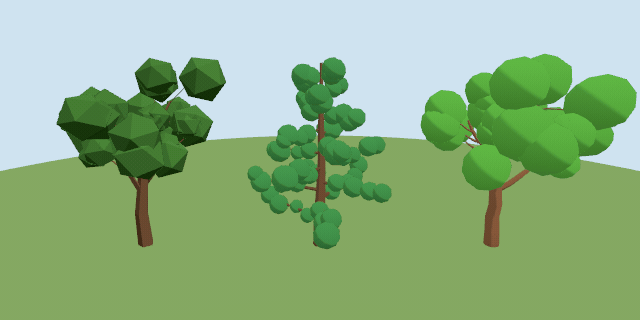

Wind has a scene-wide part (direction and strength) and a per-tree part (the Definition's `wind`
response: how much the trunk, branches and leaves move). Every tree sways with the shared `sceneWind`
unless you give it another `Wind`. All of it is uniforms, so changing the wind is free:

```ts
import { createTree, sceneWind, Wind } from '@casmo/tree.js';

sceneWind.set({ direction: [1, 0, -0.4], strength: 0.6 }); // 0 = calm (default), 1 = strong
const swaying = createTree({ schemaVersion: 3, wind: { trunk: 0.4, branches: 0.8, leaves: 1 } }, { seed: 1 });

// A separate wind, e.g. for a sheltered courtyard:
const breeze = new Wind({ direction: [0, 0, 1], strength: 0.2 });
const sheltered = createTree({ schemaVersion: 3 }, { seed: 2, wind: breeze });

swaying.windResponse.set({ leaves: 0.5 }); // change one tree's response live
sceneWind.time = 1.5; // pin the wind clock (seconds), e.g. for screenshots; null = the renderer's clock
scene.add(swaying, sheltered);
```

A swaying tree needs a render loop (`renderer.setAnimationLoop`).

### Wind Burst

A Wind Burst is a short, local push of air from a point on the ground, e.g. where the player places a
building: trees within its radius bend away from it, the front rolls outward at 30 m/s, and the push
springs back once and fades out within 1.2 s of Wind time. It adds to the Wind on trunk, branches and
leaves, scaled by each tree's Wind response, also when the Wind is calm:

```ts
import { createTree, sceneWind } from '@casmo/tree.js';

const tree = createTree({ schemaVersion: 3 }, { seed: 1 });
tree.position.set(3, 0, 0);

sceneWind.burst({ x: 1, z: 0, strength: 1, radius: 6 }); // radius defaults to 8 m per unit of strength
sceneWind.burst({ x: 1, z: 0, strength: -0.5 }); // reduced motion: lean away and settle, no swing
console.log(sceneWind.bursts.length); // the bursts running now
```

Up to 8 bursts (`MAX_WIND_BURSTS`) run at once per Wind; another one replaces the oldest. A burst starts
at the Wind's current time (its pinned `time`, or the renderer clock), so a pinned clock holds it still.
It only writes uniforms: with no burst running the shader loop runs zero times and trees look exactly
as without bursts. The Wind-aware velocity channel (TRAA, motion blur) includes burst motion.

Forests take the bursts of their Wind too: every Forest tree bends away from the burst point from its
own position and rotation, at every Detail Level, and Impostors sway with it, so the whole park reacts:

```ts
import { createForest, sceneWind } from '@casmo/tree.js';

const forest = createForest({ schemaVersion: 3 }, [{ position: [0, 0, 0] }, { position: [20, 0, 0] }], { lod: true });
scene.add(forest);

sceneWind.burst({ x: 2, z: 0, strength: 1, radius: 6 }); // the first tree bends, the second does not
```

Impostors also include their sway, bursts and all, in the Wind-aware velocity channel.

## Forests

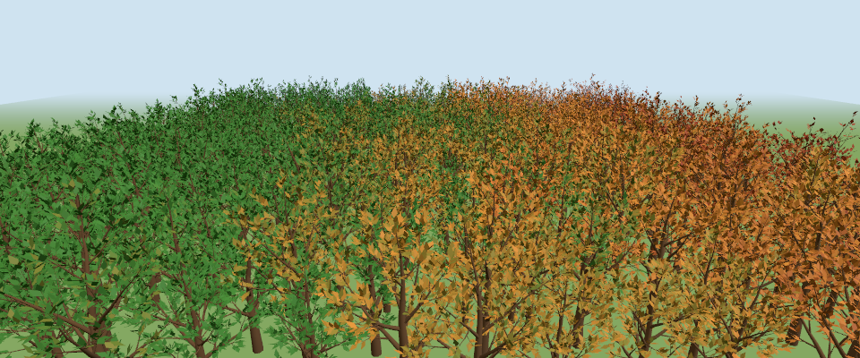

*400 trees from 4 Variants, with a per-tree Season (autumn towards the right).*

A Forest draws many trees of one Definition from a few Variants (Seeds), each instanced, so 1,000 trees
cost two draw calls per Variant (three with Fruit: `variant.fruit` is a third instanced mesh, null without
Fruit). Every tree still looks its own: its Variant, rotation, Growth delay,
Season shift and wind phase come from a hash of the forest seed and the tree's id (or position), so adding
or removing trees never changes the others.

```ts
import { Raycaster } from 'three/webgpu';
import { createForest, type ForestPlacement } from '@casmo/tree.js';
import lowPoly from '@casmo/tree.js/styles/low-poly';

const placements: ForestPlacement[] = [];
for (let i = 0; i < 400; i++) {
  placements.push({ id: i, position: [(i % 20) * 4, 0, Math.floor(i / 20) * 4], rotation: i * 2.4, scale: 0.8 + (i % 5) * 0.1 });
}
const forest = createForest(lowPoly.conifer, placements, { variants: 4, seed: 1, growth: 1, season: 0.3 });
scene.add(forest);

forest.season = 0.65; // every tree, each with its own shift
forest.addTree({ id: 'new', position: [-4, 0, 0] });
forest.removeTree(17); // by id, key or ForestTree
const tree = forest.get('new');
if (tree) tree.growth = 0.3; // per-tree Growth and Season

// Which tree did the user click?
const raycaster = new Raycaster(); // set from the pointer: raycaster.setFromCamera(pointer, camera)
const [hit] = raycaster.intersectObject(forest);
if (hit) console.log(forest.treeAt(hit)?.key);
```

`forest.dispose()` frees everything. `forest.ready` resolves once its textures have loaded.

### Detail Levels

Far trees cover a few pixels but still cost their full mesh. With `lod` a Forest draws each tree at a
**Detail Level** for its distance from the camera: **Full** up close, **Light** (the same Variant
regenerated with fewer faces and larger leaves, every branch in place) in the middle distance, and an
**Impostor** far away: one camera-facing card per tree, lit by your lights from baked normals, that still
follows Season (leaf colour, leaf drop down to bare branches, blossom) and sways in the Wind. Neighbouring
levels cross-fade with an ordered dither, so trees never pop. A compute pass picks the levels on the GPU
every frame and fills indirect draws, so there is no per-tree work on the CPU. A tree that is not fully
grown is never an Impostor.

```ts
import { createForest, type ForestPlacement } from '@casmo/tree.js';
import lowPoly from '@casmo/tree.js/styles/low-poly';

declare const placements: ForestPlacement[]; // thousands of trees

// Light from 30 m, Impostor from 90 m (distances are divided by a tree's placement scale),
// cross-fading over 10% of the switch distance. `lod: true` uses 6 and 20 trunk heights.
const forest = createForest(lowPoly.broadleaf, placements, { variants: 4, lod: { light: 30, impostor: 90, fade: 0.1 } });
scene.add(forest);
renderer.render(scene, camera); // the first frame finds the backend and draws every tree in full
await forest.lodReady; // Detail Levels drawn, Impostors baked (far trees draw Light until then)

forest.lod = { impostor: 120 }; // distances, fade and the camera that picks the levels are live: no rebuild
```

- Detail Levels need WebGPU (compute and indirect draws). On WebGPURenderer's WebGL2 fallback a `lod`
  Forest draws every tree in full, exactly as without `lod`, with one console warning. Without `lod` nothing
  changes: no extra meshes, buffers or bake.
- The backend is only known when the Forest is first drawn: three.js hands it the renderer during that
  render, after the frame's draw list is made. So on WebGPU the **first frame draws every tree in full**
  (one full-cost frame), the Detail Levels take over from the next frame, and far trees switch from Light
  to Impostor once the bake is done; on the WebGL2 fallback `lodReady` resolves on that first render, not
  at once. To show neither switch, render once and `await forest.lodReady` before the forest is seen.
- One camera picks every tree's level: the first non-shadow camera that draws the Forest in a frame, or
  `lod.camera`. Shadow passes and other cameras reuse its levels.
- Raycasting, `forest.treeAt`, `addTree`/`removeTree`, live Material Features and Tree Effects work as
  without `lod`, at every Detail Level.
- **Memory**: the Impostors are baked into atlases of `impostorAtlas.size`² pixels (default 2048, with
  `frames` 12 × 12 directions from the horizon to straight above), in two render targets per Variant: the
  tree (colour, normals, Season data, and Material Feature inputs when the Definition sets them) and the
  wood alone (colour, normals: shown where leaves have dropped). Each atlas is RGBA8 with mipmaps, about
  21 MiB at 2048, and each render target has a depth buffer of the same size (16 MiB). That is about
  139 MiB of GPU memory per Variant (five atlases), 160 MiB with Material Features (six), so 555 MiB or
  640 MiB for 4 Variants. Halving `size` quarters it (`impostorAtlas: { size: 1024 }`: about 35 MiB per
  Variant); fewer `frames` keep the memory and give each direction more pixels. `forest.dispose()` frees them.

[`examples/large-forest`](examples/large-forest/main.ts) draws 10,000 trees under an orbiting camera and
rebuilds the Forest with Detail Levels on or off, measuring both runs side by side. One example run
(not a guarantee; measure on your own hardware):

| 10,000 trees, 4 Variants | Detail Levels off | Detail Levels on (`lod: true`) |
| --- | --- | --- |
| frame time, average / p95 | 2,988 / 6,207 ms | 264 / 441 ms |
| draw calls | 10 | 22 |
| triangles drawn | 12,520,003 | 450,869 |
| trees Full / Light / Impostor | 10,000 / 0 / 0 | 40 / 1,639 / 8,630 |

*Measured with `?orbit=30` (camera pinned), 120 frames at 640 × 480, in headless Chromium (Playwright 1.65)
whose WebGPU runs on SwiftShader, a CPU rasterizer, on an AMD Ryzen 9 7900 that was also running other jobs.
That is why a frame takes seconds; on a GPU the frames are far faster and the ratio differs. The extra draw
calls are the indirect draws of every Variant and level, issued even when a level is empty.*

## Material Features

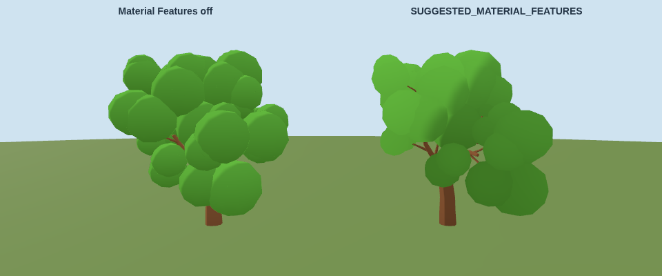

*The same tree and lights, without (left) and with (right) `SUGGESTED_MATERIAL_FEATURES.stylized`.*

Material Features make a crown read as one soft volume instead of a noise of leaf cards. There are
three, each an optional field in the Definition's `materials` section:

| Field | Range | What it does |
| --- | --- | --- |
| `materials.leaf.crownNormals` | 0..1 | **Crown Normals**: each leaf's normal is blended towards the [Crown Volume](#tree-definitions-and-seeds)'s, so the crown is lit as one rounded shape (0 = each leaf on its own .. 1 = fully). With flat shading the facets stay visible below 1. |
| `materials.leaf.translucency` | `{ strength, edge, ambient }`, each 0..1 | **Leaf Translucency**: leaves glow in their own Season colour when you look towards a light through them. `strength` per direct light (shadowed leaves don't glow), `edge` = how much more the thin edge of the crown glows than its inside, `ambient` = the sky shining through, dimmed by occlusion. Leaves only, never bark or Fruit. |
| `materials.occlusion` | `{ strength }`, 0..1 | **Structural Occlusion**: the inside of the crown and the trunk under it get less ambient light. Worked out once from the tree's shape (baked per vertex, the same for every Season), for wood, leaves and Fruit. Changing `strength` doesn't regenerate the tree. |

**They are strictly opt-in and pass-free.** Absent means off, and no built-in Style or Species turns one
on, so a game that sets nothing sees exactly the trees it saw before (same geometry, attributes and
materials). Turning one on only changes the tree's own node materials: your renderer, scene, lights and
post-processing are left alone, and there is no extra render pass, only some shader math per pixel. They
work in every Style (flat, standard and toon shading), with Growth and Wind, and in Forests.

Each Style has suggested values. Opt in with one line: `withMaterialFeatures(definition, features)`
returns a new Definition whose Material Features are exactly `features` (a feature you leave out is off,
`{}` turns them all off) and leaves its input unchanged:

```ts
import { createTree, SUGGESTED_MATERIAL_FEATURES, withMaterialFeatures } from '@casmo/tree.js';
import { oak } from '@casmo/tree.js/species';
import realistic from '@casmo/tree.js/styles/realistic';
import stylized from '@casmo/tree.js/styles/stylized';

const tree = createTree(withMaterialFeatures(stylized.broadleaf, SUGGESTED_MATERIAL_FEATURES.stylized), { seed: 3 });

// Or your own values, e.g. only a little crown shading and occlusion:
const subtle = withMaterialFeatures(realistic.apply(oak), { crownNormals: 0.4, occlusion: { strength: 0.5 } });
const off = withMaterialFeatures(subtle, {}); // the plain Style tree again
```

| Style | `crownNormals` | `translucency` | `occlusion` |
| --- | --- | --- | --- |
| `low-poly` | 0.5 | (off: it would soften the flat look) | `{ strength: 0.8 }` |
| `stylized` | 1 | `{ strength: 0.3, edge: 0.8, ambient: 0.2 }` | `{ strength: 0.9 }` |
| `realistic` | 0.6 | `{ strength: 0.45, edge: 0.7, ambient: 0.25 }` | `{ strength: 0.9 }` |

The fields are plain numbers, so they are saved in the Definition JSON (the Tree Editor exports them) and
can be set with `extendDefinition` too (`{ materials: { leaf: { crownNormals: 1 } } }`). Validation
rejects values outside 0..1.

**Tuning live.** A feature that is on can be retuned on a Tree or Forest without regenerating it: the
values are uniforms, so there is no new geometry and no recompile. Values are clamped to 0..1; setting a
feature that is off throws (switching one on or off needs a new Tree or Forest). A Baked Tree is baked
with the values as tuned.

```ts
import { createTree, SUGGESTED_MATERIAL_FEATURES, withMaterialFeatures } from '@casmo/tree.js';
import stylized from '@casmo/tree.js/styles/stylized';

const tree = createTree(withMaterialFeatures(stylized.broadleaf, SUGGESTED_MATERIAL_FEATURES.stylized));
tree.crownNormals = 0.8;                         // number | null (null = off)
tree.translucency = { strength: 0.6 };           // any of strength, edge, ambient; the others are kept
tree.occlusionStrength = 0.5;                    // number | null
tree.materialFeatures;                           // { crownNormals?, translucency?, occlusion? } as tuned now
```

**With your SSAO/GTAO.** Structural Occlusion is the materials' built-in ambient occlusion (`aoNode`),
so it darkens ambient and indirect light only (sunlit sides stay sunlit) and three.js multiplies it
with screen-space AO the same way it does for any material. Your SSAO pass needs no changes; trees simply
bring their own occlusion, including the inside of the crown, which screen-space AO can't see:

```ts
import * as THREE from 'three/webgpu';
import { builtinAOContext, mrt, normalView, output, pass, screenUV } from 'three/tsl';
import { ao } from 'three/addons/tsl/display/GTAONode.js';

const prePass = pass(scene, camera);
prePass.setMRT(mrt({ output, normal: normalView }));
const gtao = ao(prePass.getTextureNode('depth'), prePass.getTextureNode('normal'), camera);

const scenePass = pass(scene, camera);
// GTAO and the trees' Structural Occlusion are multiplied together, for ambient light only.
scenePass.contextNode = builtinAOContext(gtao.getTextureNode().sample(screenUV).r);

const pipeline = new THREE.RenderPipeline(renderer);
pipeline.outputNode = scenePass;
renderer.setAnimationLoop(() => pipeline.render());
```

Material Features are a different thing from [Tree Effects](#tree-effects): those are post-processing
(the "leaf glow" effect is a screen-space bloom, not Leaf Translucency). See them side by side per Style in
[`examples/material-features`](examples/material-features/main.ts).

## Tree Shader Hook

A Tree Shader Hook is the one supported way to change how a tree's surface is shaded (snow, rain, drought
colour, a painterly foliage look) without touching its materials. You hand the library a
[TSL](https://threejs.org/docs/#api/en/nodes/TSL) function per tree part (`bark`, `leaves` or `fruit`),
and it applies it inside that part's node materials, which it keeps building and rewiring itself for
Growth, Season and Wind. Don't patch `tree.leaves.material` yourself; set a hook instead.

The hook gets TSL nodes for the fragment it shades and returns a colour (lit as before), or a colour and a
roughness:

| Input | What it is |
| --- | --- |
| `color` | The base colour (linear rgb): after Season, Ground Tint, textures and the Seed's tint, before lighting |
| `roughness` | The part's roughness before the hook |
| `normal` | The world-space normal the fragment is lit with, after Wind and Growth (and Crown Normals, the bark normal map) |
| `position`, `treePosition` | The fragment's world position, and the tree's own (the foot of its trunk) |
| `season`, `growth` | The tree's Season and Growth (0..1) |
| `part`, `shading` | The tree part, and the Style's shading (`'flat'`, `'toon'` or `'standard'`) |

```ts
import { createTree, type TreeShaderHook } from '@casmo/tree.js';
import stylized from '@casmo/tree.js/styles/stylized';
import { mix, smoothstep, uniform, vec3 } from 'three/tsl';

const frost = uniform(0.5); // animate the hook with uniforms: no rebuild
const frosty: TreeShaderHook = ({ color, normal, roughness }) => ({
  color: mix(color, vec3(0.9, 0.95, 1), smoothstep(0.3, 0.8, normal.y).mul(frost)),
  roughness: roughness.mul(0.8),
});

const tree = createTree(stylized.broadleaf, { seed: 3, shaderHooks: { leaves: frosty } });
tree.shaderHooks = { leaves: frosty, bark: frosty }; // set or change at runtime
tree.shaderHooks = {};                               // remove: the tree is drawn exactly as before
```

`tree.shaderHooks` holds the hooks per part of a `Tree`; a part whose hooks didn't change is left alone. A
hook is called once when it is set, to build the node graph, not per frame. Setting, changing or removing it
rebuilds the node graph of that part's material once (a shader recompile) and never the geometry. With no
hook nothing changes: same geometry, attributes and materials as before. It works on WebGPU and on the
WebGL2 fallback.

### On Forests, Detail Levels and Impostors

A `Forest` takes hooks the same way, for every tree in it, near and far:

```ts
import { createForest } from '@casmo/tree.js';
import stylized from '@casmo/tree.js/styles/stylized';
import { mix, vec3 } from 'three/tsl';

const forest = createForest(stylized.broadleaf, [{ position: [0, 0, 0] }, { position: [6, 0, 2] }], {
  lod: true,
  shaderHooks: { leaves: ({ color }) => mix(color, vec3(0.9, 0.6, 0.2), 0.5) },
});
forest.shaderHooks = {}; // set, change or remove at runtime, as on a Tree
```

The hook runs at every [Detail Level](#detail-levels): Full and Light trees share the Variant's materials,
and Impostors apply it while they are drawn, to their baked colour, normals and Season data, with
`part` set per texel (bark or leaves; Impostors have no Fruit). So far trees follow a hook, and its
uniforms, live: changing a hook never rebakes an Impostor. `season`, `growth` and `treePosition` are each
tree's own.

### Scene-wide default and stacking

`setSceneShaderHooks` sets hooks every Tree and Forest runs, now and when created later, the way
`sceneWind` is shared:

```ts
import { createTree, setSceneShaderHooks, stackShaderHooks, type TreeShaderHook } from '@casmo/tree.js';
import stylized from '@casmo/tree.js/styles/stylized';
import { vec3 } from 'three/tsl';

const dusk: TreeShaderHook = ({ color }) => color.mul(vec3(1, 0.85, 0.7));
const pale: TreeShaderHook = ({ color }) => color.mul(1.2);
setSceneShaderHooks({ bark: dusk, leaves: dusk });

const tree = createTree(stylized.broadleaf, {
  shaderHooks: {
    leaves: pale, // stacks: dusk, then pale
    bark: null,   // overrides: no hook on this tree's bark, not even the scene-wide one
  },
});
tree.shaderHooks = stackShaderHooks({ leaves: pale }, { leaves: dusk }); // several sets of hooks, joined per part
setSceneShaderHooks({}); // remove the scene-wide default
```

Per part, a Tree's or Forest's hooks work like this:

- **left out** (or `undefined`): only the scene-wide default's hooks run;
- **a hook or a list of hooks**: they stack after the scene-wide default's;
- **`null`**: no hook at all on that part, the scene-wide default is overridden.

Stacked hooks run in a fixed order: first the ready-made hooks the library ships (such as Snow Cover and
Wetness), then the app's own; within each group the scene-wide default's before the Tree's or Forest's,
each list in the order given. Each hook gets the colour and roughness the one before it returned. A hook
that is listed twice runs once.

### The normal after Wind

`normal` is the normal after Wind on every Style. three only moves a flat-shaded (low-poly) facet with the
swayed vertices; on smooth shading the library turns the lit normal by how the Wind turned the surface
(the facet of the unswayed positions to the swayed one, from screen-space derivatives). That costs one
varying and a few instructions, and only in a hook that reads `normal`. On an Impostor the baked normal is
turned with the card's sway the same way.

### Snow Cover

Snow Cover is a ready-made Tree Shader Hook that whitens the surfaces of trees that face up, by a
scene-wide snow amount from 0 (none) to 1 (full cover). The amount is shared the way `sceneWind` is:
`sceneSnow`, or a `Snow` of your own. It lives in its own entry point, `@casmo/tree.js/weather`, which
nothing else in the library imports, so a game without weather never loads it:

```ts
import { setSceneShaderHooks } from '@casmo/tree.js';
import { sceneSnow, snowCoverHooks } from '@casmo/tree.js/weather';

const snow = snowCoverHooks();
setSceneShaderHooks(snow); // every Tree and Forest, near and far (Impostors too); or `tree.shaderHooks = snow`
sceneSnow.amount = 0.8;    // driven by your weather: a uniform, no rebuild

// Settings are live too (uniform writes):
snow.set({
  color: '#f4f8ff',  // sRGB, like any three.js colour
  slope: 60,         // the steepest surface (degrees from level) that still holds snow
  softness: 25,      // degrees over which the snow thins out towards `slope` (0: a hard edge)
  strength: { bark: 1, leaves: 1, fruit: 0.5 }, // how much snow each part takes
});
```

It draws to suit the Style: hard flat caps on low-poly, toon bands on stylized, soft lit snow with a slight
sparkle on realistic. Snow is read from the `normal` after Wind, so it sways with the branches, lies on bare
winter branches when the leaves are gone, and undersides stay bare. It stacks like any hooks and always runs
before your own. At amount 0, or without the hooks set, trees look exactly as before.
`snowCoverHooks({ snow })` follows another `Snow` than `sceneSnow`. For snow of your own, start from
`snowCoverShading`, the body of the ready-made hook, which only uses the hook's inputs and the settings you
give it.

### Wetness

Wetness is a ready-made Tree Shader Hook for rain: trees get darker and get a sheen (a lower roughness),
most on surfaces that face up, by a scene-wide wetness amount from 0 (dry) to 1 (soaked). The amount is
shared the way `sceneWind` is: `sceneWetness`, or a `Wetness` of your own. It lives in its own entry
point, `@casmo/tree.js/weather`, so a game without weather never loads it:

```ts
import { createTree, setSceneShaderHooks, stackShaderHooks, type TreeShaderHook } from '@casmo/tree.js';
import stylized from '@casmo/tree.js/styles/stylized';
import { sceneWetness, wetnessHooks } from '@casmo/tree.js/weather';

const wet = wetnessHooks({ darkening: 0.5, sheen: 0.7 });
setSceneShaderHooks(wet); // every Tree and Forest, near and far (Impostors too)
sceneWetness.amount = 0.8; // driven by your weather: a uniform, no rebuild

// Settings are live too (uniform writes):
wet.set({
  color: '#d8e0ea',  // the tint wet surfaces take on
  slope: 110,        // degrees from straight up a surface may face and still get fully wet
  softness: 60,      // degrees over which it fades out around `slope` (0: a hard edge)
  strength: { bark: 1, leaves: 0.8, fruit: 0.5 }, // how much each part takes
  darkening: 0.4,    // how much darker a soaked surface gets
  sheen: 0.6,        // how much its roughness drops
});

// Stacks with your own hooks: the ready-made ones always run first.
const mine: TreeShaderHook = ({ color }) => color.mul(1.1);
const tree = createTree(stylized.broadleaf, { shaderHooks: stackShaderHooks({ leaves: mine }, wet) });
```

It draws to suit the Style: smooth on realistic, whole facets on low-poly, and toon bands with a light
glint band on top on stylized (toon lighting has no highlights for the sheen to show in). At amount 0, or
without the hooks set, trees look exactly as before. `wetnessHooks({ wetness })` follows another `Wetness`
than `sceneWetness`. For a look of your own, write your own hook instead, using this one as a model.

## Tree Effects


*Without (left) and with (right) the `stylized` suggestion: only the tree changes, the rock and crate don't.*

`@casmo/tree.js/effects` has opt-in post-processing (TSL nodes for three.js `RenderPipeline`) that only
changes the pixels of trees: an **outline**, a **leaf glow** and **colour grading**. Trees look fine
without them. Every tree.js material (wood, leaves and Fruit, of Trees and Forests) is found automatically (a per-object tree mask in
an MRT output), so no tree has to be registered.

```ts
import { createTreeEffects } from '@casmo/tree.js/effects';

const effects = createTreeEffects(renderer, scene, camera, { effects: 'stylized' }); // the Style's suggested combination
renderer.setAnimationLoop(() => effects.render()); // instead of renderer.render(scene, camera)
effects.set({ outline: { color: '#203018', thickness: 2 }, grade: { saturation: 1.1 } }); // or null = none
```

Each Style has a suggested combination (`SUGGESTED_TREE_EFFECTS`): `low-poly` has a colour grade, ink
[Inner Lines](#inner-lines) and a dark outline that is also drawn [between overlapping trees](#outline-between-overlapping-trees);
`stylized` has a warm grade, a leaf glow, soft Inner Lines and a soft outline; `realistic` only a gentle
grade and a faint leaf glow (no ink).

> **Changed in this release:** the `low-poly` and `stylized` suggestions now include Inner Lines, and
> `low-poly` also `outline.betweenTrees`. Apps that use either suggestion get a changed look (ink lines
> inside the crown, and for low-poly between overlapping trees) and extra channels in the scene pass:
> the `normal` channel for both, and for low-poly also the [Tree ID](#tree-id) channel (a scene pass with
> the Tree ID renders without MSAA). In your own pipeline, request those channels from `treeEffectsPass`
> (see below). Use your own settings, e.g. `{ ...SUGGESTED_TREE_EFFECTS.stylized, innerLines: undefined }`,
> to keep the old look.

Pass `selection: [tree]` to outline only some trees. In your own pipeline, the effects are nodes that
compose with your other effects:

```ts
import * as THREE from 'three/webgpu';
import { float, screenUV, vec4 } from 'three/tsl';
import { applyTreeEffects, SUGGESTED_TREE_EFFECTS, treeEffectsPass } from '@casmo/tree.js/effects';

const pipeline = new THREE.RenderPipeline(renderer);
// The low-poly suggestion's Inner Lines need the normal channel, its betweenTrees outline the Tree ID.
const input = treeEffectsPass(scene, camera, null, { normal: true, treeId: true }); // { pass, color, mask, ... }
const trees = applyTreeEffects(input, SUGGESTED_TREE_EFFECTS['low-poly']); // or treeOutline / leafGlow / treeColorGrade
const vignette = float(1).sub(screenUV.sub(0.5).length().mul(0.9).pow(2)); // your own effect on top
pipeline.outputNode = vec4(trees.rgb.mul(vignette), 1);
renderer.setAnimationLoop(() => pipeline.render());
```

To add the tree mask to a scene pass you already have, merge `treeMaskMRT()` into its MRT and read the
mask with `scenePass.getTextureNode(TREE_MASK)`.

### Tree ID

To tell trees apart on screen (GPU picking, your own per-tree effects), add the opt-in **Tree ID**
channel: an extra MRT target in which every tree writes its own number. Each Tree has one ID for all
its parts (wood, leaves, Fruit), and each tree of a Forest has its own. Nothing else changes: the tree
mask, its format and the `treeEffectsPass` default stay as they are.

```ts
import { mrt, output, pass } from 'three/tsl';
import { readTreeId, TREE_ID, treeFromId, treeIdMRT, treeIdTexture, treeMaskMRT } from '@casmo/tree.js/effects';

const scenePass = pass(scene, camera);
scenePass.setMRT(mrt({ output }).merge(treeMaskMRT()).merge(treeIdMRT()));
treeIdTexture(scenePass); // makes the target one 32-bit unsigned integer per pixel
const ids = scenePass.getTextureNode(TREE_ID); // read it with exact texel loads (ids.load(...)), never filtered

renderer.domElement.addEventListener('click', async (event) => {
  const id = await readTreeId(renderer, scenePass, event.offsetX, event.offsetY); // CSS pixels
  const tree = treeFromId(id); // the Tree or ForestTree, or undefined (0 = no tree)
});
```

- **Encoding:** `r32uint`, 0 = not a tree. A Forest Variant reserves a block of IDs the size of its
  capacity, and its trees write block start + slot, at every Detail Level (Impostors included). The
  tree mask, outline, Inner Lines and Highlight work on far trees too; raycasting and `forest.treeAt`
  keep hitting the full meshes.
- **No MSAA:** an integer target cannot be multisampled, so turning on the Tree ID turns MSAA off on
  that scene pass: `treeIdTexture` sets `samples: 0`, also with an `antialias: true` renderer. This
  applies wherever the ID channel is on: `treeIdTexture`, `treeEffectsPass(..., { treeId: true })`,
  and in `TreeEffects` the `treeId: true` option, `outline.betweenTrees`, `highlight` and the
  `low-poly` suggestion (which uses `betweenTrees`). Add FXAA or SMAA after the pass if you need
  smooth edges there.
- **Limits:** IDs are handed out by one registry for the whole page on first use: the first time a
  tree is drawn with the channel or asked for with `treeIdOf(tree)`, whichever comes first. They are
  never reused: about 4.29 billion per session. The registry keeps no tree alive. The ID ignores the
  outline's `selection`.
- **Frame-relative:** a Forest tree's ID follows its instance slot. Removing a tree (the last tree
  moves into its slot) or a Variant growing past its capacity can change the IDs of other trees. So
  resolve an ID with `treeFromId` in the frame it was read, and ask `treeIdOf(tree)` for a tree's
  current ID; a removed tree resolves to `undefined`.
- `readTreeId` reads the pixel under a point of the canvas from the last render of the pass (it
  handles the target's index, the y flip and the device pixel ratio). It works on WebGPU and on the
  WebGL2 fallback.
- **WebGL2 fallback:** three clears every target there as floats, which is invalid for an integer
  target, so `treeIdTexture` makes the pass clear the ID target itself right before every render (a
  frame with nothing drawn reads 0). three's own clear still logs a GL warning
  (a `GL_INVALID_OPERATION` from `clearBufferfv`) in the console each frame; it is harmless.

#### Picking with `TreeEffects` and the opt-in channels

The ready-made pipeline only renders the channels its settings need. Without them (`effects: null`,
or grade, glow and outline without `betweenTrees`) the scene pass is exactly `{ output, treeMask }` with the 8-bit mask, as
always. Pass `treeId: true` to keep the Tree ID channel on without any effect needing it, then pick
with one call:

```ts
import { createTreeEffects } from '@casmo/tree.js/effects';

const effects = createTreeEffects(renderer, scene, camera, { effects: 'stylized', treeId: true });
renderer.domElement.addEventListener('pointermove', async (event) => {
  const tree = await effects.pick(event.offsetX, event.offsetY); // Tree, ForestTree or undefined
});
```

`pick` reads the ID from the last render and resolves it right away (IDs are frame-relative). Without
the Tree ID channel it throws an error that names the `treeId` option. The scene pass's MRT (and with
it the compiled materials of your scene) only changes when `set()` needs a different set of channels;
switching between settings that need the same channels keeps it. When the channels do change,
`effects.scenePass` is a new pass (three cannot remove a target from a pass, nor turn MSAA back on
for it), so read `effects.scenePass` again after such a `set()` instead of keeping the old one. In your own pipeline,
`treeEffectsPass(scene, camera, selection, { treeId: true })` adds the channel and fills in the
effects' `treeId` input.

#### Outline between overlapping trees

By default the outline goes around all trees together, so trees that overlap on screen merge into one
shape. With `betweenTrees` the outline is also drawn where a tree lies in front of another one, for a
Tree and a Tree, two Forest trees, or a Tree and a Forest tree:

```ts
import { createTreeEffects } from '@casmo/tree.js/effects';

const effects = createTreeEffects(renderer, scene, camera, {
  effects: { outline: { color: '#18230f', thickness: 2, betweenTrees: true } },
});
```

The line is drawn on a selected tree pixel when the pixel `thickness` px away is another tree (a
different Tree ID) that is further away, so it lies on the front tree's side, with the outline's own
colour, thickness and strength (with a standard, reversed or logarithmic depth buffer). It is off by
default (the outline stays as it was). It needs the Tree
ID: `TreeEffects` turns the channel on for it, and switching `betweenTrees` on or off builds a new
graph. In your own pipeline, use `treeEffectsPass(scene, camera, selection, { treeId: true })`, which
also fills in the `depth` input; `treeOutline` throws when the `treeId` or `depth` input is missing.

### Inner Lines

**Inner Lines** are ink lines inside the trees where the surface folds or steps away from the viewer,
such as around each leaf clump, on top of the outline around the tree. They come from depth edges
(a relative step `|Δz| / z`, so they look the same near and far) and normal edges (`1 − dot`), are
only drawn on tree pixels of every tree (whatever the `selection`) and only from neighbours that are
tree pixels too: the silhouette is left to the outline. They work with a standard, reversed
(`reversedDepthBuffer`) or logarithmic (`logarithmicDepthBuffer`) depth buffer.

```ts
import { createTreeEffects } from '@casmo/tree.js/effects';

const effects = createTreeEffects(renderer, scene, camera, {
  effects: { outline: {}, innerLines: { color: '#1d2a14', thickness: 1, strength: 1, normalThreshold: 0.4, depthThreshold: 0.02 } },
});
```

Inner Lines need view normals, so with `innerLines` the ready-made pipeline adds a `normal` channel
(RGBA8) to its scene pass; without it the pass stays `{ output, treeMask }`. Order of the effects:
grade, glow, inner lines, outline. In your own pipeline, `treeEffectsPass(scene, camera, selection, { normal: true })`
fills in the `normal`, `depth` and `camera` inputs, or merge `treeNormalMRT()` into your scene pass.
`innerLines()` throws an error naming the missing input when `normal`, `depth` or `camera` is missing.

If your pipeline already renders normals (for GTAO, SSR and the like), pass that texture instead of
rendering them twice, with its encoding: `'color'` (default, `directionToColor(normalView)` in an
RGBA8 target) or `'direction'` (the normal itself, e.g. in a float target):

```ts
import * as THREE from 'three/webgpu';
import { mrt, normalView, output, pass } from 'three/tsl';
import { innerLines, TREE_MASK, treeMaskMRT, treeOutline } from '@casmo/tree.js/effects';

const scenePass = pass(scene, camera);
scenePass.setMRT(mrt({ output, normal: normalView }).merge(treeMaskMRT())); // your MRT, plus the tree mask
scenePass.getTexture(TREE_MASK).type = THREE.UnsignedByteType;
const normal = scenePass.getTextureNode('normal'); // also feeds your GTAO / SSR
const input = {
  color: scenePass.getTextureNode('output'),
  mask: scenePass.getTextureNode(TREE_MASK),
  depth: scenePass.getTextureNode('depth'),
  camera,
  normal,
  normalEncoding: 'direction' as const,
};
const lined = innerLines(input, { strength: 0.8 });
const pipeline = new THREE.RenderPipeline(renderer);
pipeline.outputNode = treeOutline({ ...input, color: lined });
```

### Highlight

**Highlight** marks the trees you point out, such as the one under the cursor: it brightens and tints
them and draws a ring just outside them, optionally pulsing. It is the one Tree Effect that also
changes pixels next to a tree (its ring). It is never on by default and in no suggestion. It needs
the Tree ID, so `highlight` turns that channel on (and with it `pick`):

```ts
import { createTreeEffects } from '@casmo/tree.js/effects';

const effects = createTreeEffects(renderer, scene, camera, {
  effects: { outline: {}, highlight: { color: '#ffe066', tint: 0.25, brightness: 1.25, outlineColor: '#ffd23f', thickness: 2, pulse: 0 } },
});
renderer.domElement.addEventListener('pointermove', async (event) => {
  const tree = await effects.pick(event.offsetX, event.offsetY);
  effects.highlighted.splice(0, effects.highlighted.length, ...(tree ? [tree] : [])); // read every frame, no recompile
});
```

- `highlighted` (an option, or the `effects.highlighted` list) holds Trees and Forest trees, not a
  Forest or a group. Change it in place; it is read every frame. At most 64 trees are highlighted at
  once (one console warning beyond that). Removed, disposed and undrawn trees are skipped.
- Options: `color` and `tint` (0..1) of the tint, `brightness` (a multiplier), `outlineColor` and
  `thickness` (px) of the ring, `strength` (0..1) and `pulse` (Hz, 0 = off): tint and brightness swing
  between their value and half of it, the ring stays solid.
- It is applied last (grade, glow, inner lines, outline, then highlight), so it is always on top. In your own
  pipeline: `treeHighlight(input, highlighted, options)`, with the `treeId` input of
  `treeEffectsPass(scene, camera, null, { treeId: true })`, or `applyTreeEffects(input, settings, highlighted)`.

### Custom Tree Effects

Add a Tree Effect of your own to `TreeEffects`, such as a brush look on the foliage only. It is built
the way the built-in ones are: from the colour so far and the tree mask, returning a colour node and an
`update()` that changes its uniforms live. The tree mask's `r` is 1 on any tree pixel, `g` on leaf
pixels only and `b` on the selected trees'.

```ts
import { mix, uniform, vec4 } from 'three/tsl';
import { createTreeEffects, type CustomTreeEffect } from '@casmo/tree.js/effects';

const foliage: CustomTreeEffect<{ strength: number }> = {
  before: 'outline', // where it runs among the built-in effects (default: last, under the Highlight)
  // channels: { treeId: true, normal: true }, // only if it reads them: the scene pass adds them
  build(input, options) {
    const strength = uniform(options.strength);
    const look = input.color.rgb; // your look here (this is the bare pass-through)
    const node = vec4(mix(input.color.rgb, look, input.mask.g.mul(strength)), input.color.a);
    return { node, update: (next) => (strength.value = next.strength) };
  },
};

const effects = createTreeEffects(renderer, scene, camera, { effects: 'stylized' });
effects.addEffect(foliage, { strength: 1 });
effects.updateEffect(foliage, { strength: 0.5 }); // live: no new graph, no recompile
effects.removeEffect(foliage);
```

- `before` names a built-in effect (`'grade'`, `'glow'`, `'innerLines'`, `'outline'` or `'highlight'`);
  the custom effect runs right before it, whether that one is on or not. Custom effects at the same
  place run in the order they were added. The default, `'highlight'`, runs it after every other
  built-in effect and under the Highlight.
- The input has the colour so far (`color`), the tree mask (`mask`), `depth` and `camera`, plus the
  optional channels it declares in `channels` (`treeId`, `normal` with `normalEncoding`), which the scene
  pass then adds (a new scene pass, as for the built-in effects). Undeclared channels are never in its
  input, even when a built-in effect has them on.
- Custom effects stay through `effects.set()`, which rebuilds them with their latest options when it
  builds a new graph. `effects.customEffects` lists them. Adding or removing one builds a new graph.
- With no custom effect nothing changes: no channel, no pass. A custom effect itself adds no pass; it
  is part of the pipeline's output node.
- The [Scene Pipeline](#scene-pipeline) takes the same custom effects, with the same `addEffect`,
  `updateEffect`, `removeEffect` and `customEffects`: see [Custom Tree Effects in the Scene
  Pipeline](#custom-tree-effects-in-the-scene-pipeline).
- In your own pipeline, call `effect.build(input, options)` on the output of `applyTreeEffects` (or any
  colour) yourself. See [`examples/custom-effect`](examples/custom-effect/main.ts) for the bare setup of a
  foliage-only effect.

## Scene Pipeline

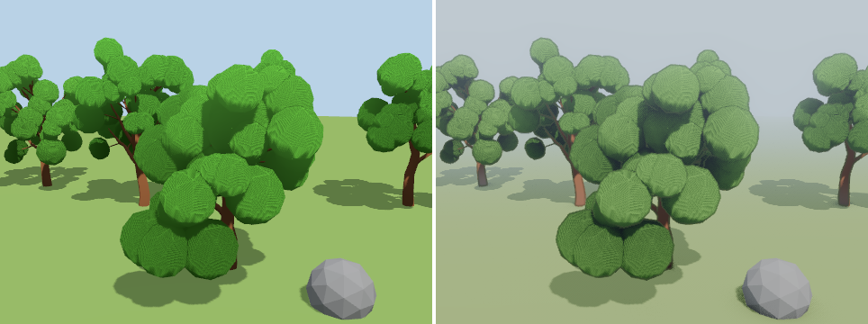

*Without (left) and with (right) `createScenePipeline(renderer, scene, camera, { style: 'stylized' })`.*

Tree Effects only change tree pixels. `@casmo/tree.js/scene` adds the whole-scene part around them,
the **Scene Effects**: tone mapping, anti-aliasing, ground-contact ambient occlusion (GTAO), bloom, fog
and god rays, plus TRAA and motion blur that see Wind. The **Scene Pipeline** renders a Style's
suggested Tree Effects and Scene Effects in one `RenderPipeline`. It is opt-in: nothing changes until
you create one. It never changes your renderer (tone mapping and the output colour space are applied
inside the pipeline; shadows and lights are yours). Its only scene change is fog (`scene.fogNode`),
and it gives your own value back.

```ts
import * as THREE from 'three/webgpu';
import { createScenePipeline } from '@casmo/tree.js/scene';

const sun = new THREE.DirectionalLight('#fff4e0', 3.5); // your own light; for god rays it casts shadows
sun.castShadow = true;
scene.add(sun);
const pipeline = createScenePipeline(renderer, scene, camera, { style: 'stylized', sun });
renderer.setAnimationLoop(() => pipeline.render()); // instead of renderer.render(scene, camera)
pipeline.set({ style: 'realistic' }); // same parts on: only uniforms change, no recompile
pipeline.dispose(); // also restores your scene.fogNode
```

`ScenePipeline` replaces `TreeEffects` (use one or the other): the same options (`selection`, `treeId`,
`highlighted`) and the same `set`, `pick`, `highlighted`, `scenePass`, `settings`, `render` and `dispose`,
plus `pipeline` (the `RenderPipeline`).
With no `style` and no overrides it adds nothing and renders exactly like `renderer.render()`.

The suggestion per Style (`SUGGESTED_SCENE_EFFECTS`, plain data). Fog is in metres, tuned for a small
forest (trees 10-30 m away); scale it up for large worlds:

| Style | Tone mapping | AA | AO | Bloom | Fog | God rays |
| --- | --- | --- | --- | --- | --- | --- |
| `low-poly` | Neutral | SMAA | light | - | distance | - |
| `stylized` | AgX | SMAA | yes | soft | distance + low mist | - |
| `realistic` | AgX | SMAA | yes | subtle | distance + mist + far haze | yes (needs `sun`) |

SMAA is in every suggestion because the [Tree ID](#tree-id) channel turns MSAA off. TRAA and motion
blur are never suggested. Override a whole group with `treeEffects` or `sceneEffects` (a Style name,
settings or `null`; no deep merge, so spread the suggestion to change a part):

```ts
import type { DirectionalLight } from 'three/webgpu';
import { createScenePipeline, SUGGESTED_SCENE_EFFECTS } from '@casmo/tree.js/scene';

const sun = scene.getObjectByName('sun') as DirectionalLight;
createScenePipeline(renderer, scene, camera, {
  treeEffects: 'low-poly', // or null: no Tree Effects
  sceneEffects: { ...SUGGESTED_SCENE_EFFECTS.realistic, antialias: 'traa', fog: { near: 60, far: 600 } },
  sun, // a DirectionalLight or PointLight that already casts shadows
});
```

- **God rays** need a `sun` that already casts shadows (with `renderer.shadowMap.enabled` and casting
  objects). Without one they are skipped with one console warning; the pipeline never turns shadows on.
  In the open they read as a faint warm haze, under a dense canopy as light shafts.
- **Fog** takes its colour from `scene.background` when that is a plain `Color`, so far trees fade into
  the sky. `fog: { near, far, color?, mist?: { height, strength, near?, far?, farLayer? } }`.
- **TRAA** (`antialias: 'traa'`) and **motion blur** (`motionBlur: { strength?, samples? }`) turn on a
  Wind-aware velocity channel in the scene pass: swaying leaves don't ghost under TRAA, and blur with
  the sway. Without them tree materials are unchanged. Pass `velocity: true` to keep the channel on for
  your own temporal effects (`pipeline.scenePass.velocity`).
- The order is fixed: scene pass (fog in the materials, AO in the ambient light) -> Tree Effects -> god
  rays -> motion blur -> bloom -> TRAA -> tone mapping and output colour space -> SMAA / FXAA.

### Custom Tree Effects in the Scene Pipeline

A [custom Tree Effect](#custom-tree-effects) goes into the Scene Pipeline the same way as into
`TreeEffects`. It runs among the Tree Effects, at the place its `before` names, so on tree pixels and
before every Scene Effect (god rays, bloom, tone mapping and anti-aliasing see its result):

```ts
import { vec4 } from 'three/tsl';
import type { CustomTreeEffect } from '@casmo/tree.js/effects';
import { createScenePipeline } from '@casmo/tree.js/scene';

// The bare foliage-only setup of Custom Tree Effects above (put your look in place of `input.color.rgb`).
const foliage: CustomTreeEffect<{ strength: number }> = {
  before: 'outline',
  build: (input) => ({ node: vec4(input.color.rgb, input.color.a), update: () => {} }),
};

const pipeline = createScenePipeline(renderer, scene, camera, { style: 'stylized' });
pipeline.addEffect(foliage, { strength: 1 });
pipeline.updateEffect(foliage, { strength: 0.5 }); // live: no new graph, no recompile
pipeline.set({ style: 'realistic' }); // the custom effect stays, rebuilt with its latest options
pipeline.removeEffect(foliage);
```

- The channels it declares (`treeId`, `normal`) are added to the scene pass by the same rule as for the
  built-in effects, and go again when it is removed and nothing else needs them.
- With no custom effect the pipeline is unchanged. A custom effect alone (no Style, no overrides) makes
  the pipeline render through its `RenderPipeline` instead of `renderer.render()`.

### Scene Effects in your own pipeline

Every Scene Effect is also a stand-alone builder (every number and colour a uniform, every option with a
default), for apps that already have a `RenderPipeline`. Pick by what you need:

| Builder | Returns | Use it when |
| --- | --- | --- |
| `sceneToneMapping(color, { mapping, exposure })` | display colours | you want AgX / Neutral without setting `renderer.toneMapping`; set `pipeline.outputColorTransform = false` |
| `sceneAntialias(color, 'smaa' \| 'fxaa')` | display colours | edges alias (MSAA is off with the Tree ID, or you render without it); give it display colours (after `sceneToneMapping`, or `renderOutput(color)`); SMAA is sharper, FXAA cheaper |
| `sceneAntialias(color, 'traa', { depth, velocity, camera })` | linear colours | you want the smoothest still image and alpha-cut leaves; before tone mapping, velocity from `windVelocityMRT()`; sets `samples = 0` (no MSAA) on the scene pass of `depth` |
| `sceneAO(scene, camera, options)` | `{ prePass, node, context }` | trees and rocks float on the ground; set `scenePass.contextNode = context` (only ambient light darkens; the scene is drawn twice) |
| `sceneFog(options, scene.background)` | a fog node | depth and mist; set `scene.fogNode` yourself (no pipeline needed) |
| `sceneGodrays(color, depth, camera, sun, options)` | linear colours | light shafts; needs the shadow-casting `sun` and the scene pass's depth |
| `sceneMotionBlur(color, velocity, options)` | linear colours | fast camera or strong Wind; velocity from `windVelocityMRT()` |
| `sceneBloom(color, options)` | linear colours | bright skies or emissive parts should glow; before tone mapping |
| `applySceneEffects(input, settings)` | the whole stack as one node | you want a Style's look in your own pipeline (like `applyTreeEffects`) |

```ts
import * as THREE from 'three/webgpu';
import { mrt, output, pass } from 'three/tsl';
import { applyTreeEffects, SUGGESTED_TREE_EFFECTS, treeMaskMRT, TREE_MASK } from '@casmo/tree.js/effects';
import { sceneAntialias, sceneBloom, sceneMotionBlur, sceneToneMapping, windVelocityMRT, WIND_VELOCITY } from '@casmo/tree.js/scene';

const scenePass = pass(scene, camera);
scenePass.setMRT(mrt({ output }).merge(treeMaskMRT()).merge(windVelocityMRT())); // Wind-aware velocity
const color = scenePass.getTextureNode();
const trees = applyTreeEffects({ color, mask: scenePass.getTextureNode(TREE_MASK) }, SUGGESTED_TREE_EFFECTS.realistic); // grade + leaf glow: no extra channels
const blurred = sceneMotionBlur(trees, scenePass.getTextureNode(WIND_VELOCITY));
const display = sceneToneMapping(sceneBloom(blurred, { strength: 0.1 }), { mapping: 'agx' });
const pipeline = new THREE.RenderPipeline(renderer);
pipeline.outputNode = sceneAntialias(display, 'smaa');
pipeline.outputColorTransform = false; // tone mapping already output display colours
```

`applySceneEffects({ color, depth, camera, sun, velocity }, settings)` builds the same colour stack from
settings (fog and AO are not colour steps: use `sceneFog` and `sceneAO` for them). The velocity channel
(ADR 0011) is three's `velocity` (NDC per frame) plus the Wind sway since the previous frame:
`windVelocityMRT()` adds it to a scene pass under the name `WIND_VELOCITY`, and `windVelocity` is the
node for your own MRT. TRAA changes your scene pass: `sceneAntialias(color, 'traa', input)` sets its
`options.samples = 0`, because TRAA copies the depth each frame and a multisampled depth cannot be copied
(TRAA anti-aliases instead). The Scene Pipeline restores the old value when TRAA goes off.

## React Three Fiber

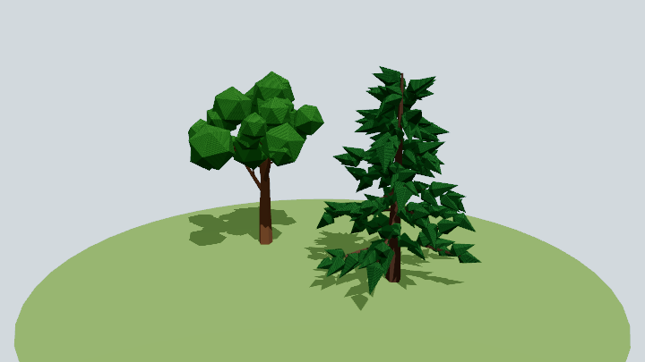

`@casmo/tree.js/react` has `<Tree>`, `<Forest>`, `<Wind>` and `useTreeStyle`. Trees use TSL node
materials, so give `<Canvas>` a `WebGPURenderer` (it falls back to WebGL2 by itself). R3F v9 takes an
async `gl` factory, which must `await renderer.init()` before it returns:

```tsx
import * as THREE from 'three/webgpu';
import { Suspense } from 'react';
import { createRoot } from 'react-dom/client';
import { Canvas } from '@react-three/fiber';
import { Forest, Tree, Wind, useTreeStyle } from '@casmo/tree.js/react';

function Trees() {
  const lowPoly = useTreeStyle('low-poly'); // dynamic import; suspends while it loads
  return (
    <>
      <Tree style={lowPoly} form="broadleaf" seed={1} growth={0.8} season={0.4} />
      <Tree style="low-poly" form="conifer" seed={2} position={[3, 0, 0]} castShadow={false} />
      <Tree definition={{ schemaVersion: 3, leaves: { count: 4 } }} seed={7} position={[-3, 0, 0]} />
      <Forest
        style={lowPoly}
        form="conifer"
        placements={[
          { id: 'a', position: [0, 0, -8] },
          { id: 'b', position: [4, 0, -9], growth: 0.5 },
        ]}
      />
    </>
  );
}

function App() {
  return (
    <Canvas
      shadows="percentage"
      camera={{ position: [9, 4, 9] }}
      gl={async (props) => {
        const renderer = new THREE.WebGPURenderer(props as THREE.WebGPURendererParameters);
        await renderer.init();
        return renderer;
      }}
    >
      <hemisphereLight args={['#ffffff', '#6a7a4a', 1.5]} />
      <directionalLight position={[5, 8, 3]} intensity={2.5} castShadow />
      <Wind direction={[1, 0, 0]} strength={0.5} />
      <Suspense fallback={null}>
        <Trees />
      </Suspense>
    </Canvas>
  );
}

createRoot(document.getElementById('root')!).render(<App />);
```

- `growth`, `season`, `wind`, `castShadow`/`receiveShadow` and `<Wind>` props only update uniforms or flags on the same tree
  (`tree.wind = otherWind` does the same outside React).
- A new `seed`, `definition` (compared by value) or `style`/`form` regenerates the tree. Trees are disposed of on unmount.
- `style` also takes a Style name (`<Tree style="low-poly" />`), which suspends like `useTreeStyle`. The `ref` is the tree.js `Tree` (or `Forest`) object.
- `<Forest>` diffs its `placements` by id: changing the array plants and cuts trees without touching the others; per-tree `growth`/`season` override the forest's.
- `<Forest lod>` takes `createForest`'s `lod`. Switching it on or off (or a new `impostorAtlas`/`lightDefinition`) rebuilds the forest; new distances, `fade` or `camera` only write `forest.lod`.
- Use `shadows="percentage"` (plain `shadows` asks for a shadow type WebGPURenderer no longer has).

`<ScenePipeline>` renders the canvas through a [Scene Pipeline](#scene-pipeline) (same options as
`createScenePipeline`). It takes over rendering (`useFrame` priority 1), follows the camera, calls `set()`
when `style`/`treeEffects`/`sceneEffects` change and disposes of the pipeline on unmount. `sun` takes a
light or a ref. The `ref` and `useScenePipeline()` (for children) give the `ScenePipeline` (`null` until
built). It lazily loads `@casmo/tree.js/scene` (so apps without it don't bundle it) and suspends on
its first render until that has loaded: put it inside a `<Suspense>` boundary (like `<Tree style>`), and
call `preloadScenePipeline()` early (e.g. at module load) to start the download before it renders.

```tsx
import { useRef } from 'react';
import type { DirectionalLight } from 'three/webgpu';
import { ScenePipeline, useScenePipeline } from '@casmo/tree.js/react';

function PickOnClick() {
  const pipeline = useScenePipeline(); // needs `treeId` for pick()
  return <mesh onClick={(e) => void pipeline?.pick(e.nativeEvent.offsetX, e.nativeEvent.offsetY)} />;
}

function Look() {
  const sun = useRef<DirectionalLight>(null);
  return (
    <>
      <directionalLight ref={sun} position={[5, 8, 3]} castShadow />
      <ScenePipeline style="realistic" sun={sun} treeId>
        <PickOnClick />
      </ScenePipeline>
    </>
  );
}
```

## Without a bundler: import map (CDN)


*[`examples/cdn`](examples/cdn/index.html): Growth, Season and Wind sliders, no build step.*

The package is plain ES modules, so it runs straight from a CDN with an
[import map](https://developer.mozilla.org/docs/Web/HTML/Element/script/type/importmap). Map `three`'s
entry points and the library (with a trailing-slash entry for its subpaths):

```html
<script type="importmap">
  {
    "imports": {
      "three": "https://cdn.jsdelivr.net/npm/three@0.187.0/build/three.webgpu.js",
      "three/webgpu": "https://cdn.jsdelivr.net/npm/three@0.187.0/build/three.webgpu.js",
      "three/tsl": "https://cdn.jsdelivr.net/npm/three@0.187.0/build/three.tsl.js",
      "three/addons/": "https://cdn.jsdelivr.net/npm/three@0.187.0/examples/jsm/",
      "@casmo/tree.js": "https://cdn.jsdelivr.net/npm/@casmo/tree.js/dist/index.js",
      "@casmo/tree.js/": "https://cdn.jsdelivr.net/npm/@casmo/tree.js/dist/"
    }
  }
</script>
<script type="module">
  import * as THREE from 'three/webgpu';
  import { createTree, loadStyle } from '@casmo/tree.js';
  import { createTreeEffects } from '@casmo/tree.js/effects.js'; // subpaths: dist/<name>.js

  const lowPoly = await loadStyle('low-poly'); // or import '@casmo/tree.js/styles/low-poly.js'
  const tree = createTree(lowPoly.broadleaf, { seed: 3 });
  // ...the same scene setup as in the quick start
</script>
```

Styles and the realistic textures load relative to the library's URL, so they come from the CDN too. See
[`examples/cdn/index.html`](examples/cdn/index.html) for a complete page (with Growth, Season and Wind sliders).

## Baked Trees (glTF export)

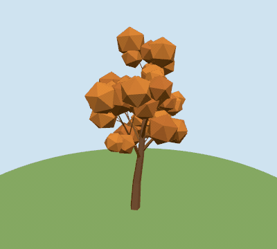

*A `.glb` from `exportBakedTree(tree, { season: 0.6 })`, loaded back with three.js' `GLTFLoader`.*

A Baked Tree is a static copy of one tree at a fixed Growth and Season (no Growth, Season or Wind left), with
classic `MeshStandardMaterial`s, for other engines or tools. It has meshes `wood`, `leaves` and, when Fruit
shows at the baked Growth and Season, `fruit`:

```ts
import { bakeTree, createTree, disposeBakedTree, exportBakedTree } from '@casmo/tree.js';

const tree = createTree({ schemaVersion: 3 }, { seed: 4 });
const glb = await exportBakedTree(tree, { growth: 1, season: 0.6 }); // ArrayBuffer (.glb); binary: false = glTF JSON
const url = URL.createObjectURL(new Blob([glb], { type: 'model/gltf-binary' }));

const baked = bakeTree(tree, { season: 0.6 }); // a THREE.Group, e.g. for your own exporter
// ...export it, then free its geometries and materials:
disposeBakedTree(baked);
```

## Using a Baked Tree in other engines

A Baked Tree carries its Material Features (Crown Normals, Leaf Translucency, Structural Occlusion; see
`materials` in the Tree Definition) in standard glTF channels, so other engines can show them. With no
Material Feature set, the `.glb` is exactly what it was without them.

```ts
import { createTree, exportBakedTree, extendDefinition } from '@casmo/tree.js';

const definition = extendDefinition({ schemaVersion: 3 }, {
  materials: { leaf: { crownNormals: 1, translucency: { strength: 0.5, edge: 0.6, ambient: 0.3 } }, occlusion: { strength: 0.7 } },
});
const tree = createTree(definition, { seed: 4 });
const glb = await exportBakedTree(tree, { occlusionInVertexColors: true }); // the option works for bakeTree too
```

| glTF channel | What it holds | Unity | Godot 4 | Unreal | Blender |
| --- | --- | --- | --- | --- | --- |
| `NORMAL` | Crown Normals already blended in (flat shading: the facet normals, blended by the same amount). Flat leaf cards (`leaves.shape: 'card'`) are turned (normal and winding together) to face outward of the Crown Volume, so engines that flip the normal of back faces still light every card from the crown's outside. Solid leaf shapes keep their winding. | Imported as mesh normals; keep the importer from recalculating them. | Imported as mesh normals. | Imported as mesh normals; turn "Recompute Normals" off. | Imported as custom normals. |
| `_OCCLUSION` (float, 0..1, all meshes) | Structural Occlusion as the tree shows it: `mix(1, aOcclusion, strength)`, 0 = occluded. **Final: the strength is already applied**, use it as AO as it is. Only when `materials.occlusion` is set. | Custom attributes are not imported by default: copy it into a UV channel or vertex colour in a custom importer, then feed it to the shader's occlusion. Or use `COLOR_0` (below). | Copy it into `CUSTOM0` with a `GLTFDocumentExtension` and read it as `AO` in a `ShaderMaterial`. Or use `COLOR_0`. | Not imported: use `COLOR_0`. | Imported as a mesh attribute `_OCCLUSION`: an Attribute node, multiplied into the indirect light or the Base Color. |
| `COLOR_0` | The vertex colours (Season colour, bark shading) as without the features; times `_OCCLUSION` with `occlusionInVertexColors: true`. | A shader that multiplies vertex colour into albedo (glTFast's shaders do). | `vertex_color_use_as_albedo` on the material. | Vertex Color node into Base Color. | Color Attribute node into Base Color (the importer wires it). |
| `KHR_materials_diffuse_transmission` (leaf material) | Leaf Translucency: `diffuseTransmissionFactor` = strength, `diffuseTransmissionColorFactor` = the leaf colour (linear, mean at the baked Season). | A foliage or translucent shader: transmission or thickness from the factor, colour from the colour factor. | `backlight_enabled`, `backlight` = colour × factor. | Shading model Two Sided Foliage, Subsurface Color = colour × factor. | Mix a Translucent BSDF (the colour) into the leaf shader by the factor. |
| `extras.treejs` (leaf and bark materials) | The settings `crownNormals`, `translucency { strength, edge, ambient }`, `occlusion { strength, strengthApplied: true, inVertexColors }` (only those set) and the Crown Volume `crown { center, radii }` in the Baked Tree's space (scaled by its Growth). `occlusion.strength` is for reference: `strengthApplied: true` says `_OCCLUSION` already has it, and `inVertexColors` whether `COLOR_0` has the occlusion too. | Read the glTF JSON in a custom importer to rebuild the effects in your own shader. | Imported as metadata on the material (`extras`), or read in a `GLTFDocumentExtension`. | Not imported: read the glTF JSON. | Imported as custom properties of the material. |

Importer support differs between versions; the columns show where each value goes.

**Don't apply the occlusion strength twice:** `_OCCLUSION` (and `COLOR_0` with `occlusionInVertexColors`)
already has `materials.occlusion.strength` applied. Use `_OCCLUSION` as AO directly, and only read
`extras.treejs.occlusion.strength` if you rebuild the effect from scratch.

**`occlusionInVertexColors`** (default `false`, in `bakeTree` and `exportBakedTree`): engines that only read
vertex colours show the occlusion without a custom shader. The trade-off: `COLOR_0` darkens all light,
direct sunlight included, while Structural Occlusion in tree.js (and `_OCCLUSION` used as AO) darkens only
ambient and indirect light. Leave it off when your engine can read `_OCCLUSION`, or keep the strength lower.

## Textures


Definitions with textures (the realistic Style, or your own `materials.bark.map` / `materials.leaf.map`
URLs) load them relative to the package's `dist/textures/` by default. To serve them yourself, copy that
folder and point tree.js at it, app-wide or per tree. `realistic.apply` picks a leaf card per Leaf Type
(`realistic/leaf.png`, `leaf-lobed.png`, `leaf-palmate.png`, `leaf-compound.png`, `needles.png`,
`scale.png`) and a colour + normal pair per Bark Type (`realistic/bark.png` for furrowed, `bark-smooth.png`,
`bark-papery.png`, `bark-fibrous.png`, `bark-plated.png`, each with its `-normal.png`); all are made by
`scripts/generate-textures.mjs` (MIT, reproducible):

```ts
import { createTree, setTextureOptions } from '@casmo/tree.js';
import realistic from '@casmo/tree.js/styles/realistic';

setTextureOptions({ basePath: 'https://cdn.example.com/tree-textures/' });
const tree = createTree(realistic.conifer, {
  seed: 1,
  textures: { urls: { 'realistic/needles.png': '/my-needles.png' } }, // per-tree overrides win
});
await tree.ready;
```

## Tree Editor


The Tree Editor is a web app for designing Tree Definitions: start from a Style, change every parameter with
a live preview (Seed, Growth, Season, Wind, Tree Effects), sculpt single branches and leaf areas of one Seed
(move, delete, paint leaves), undo/redo, and export the Definition as JSON for
`createTree(definition)` (or a Baked Tree as `.glb`). It is published on GitHub Pages
([casmo.github.io/tree.js](https://casmo.github.io/tree.js/)); run it locally with `npm run dev:editor`.

## Examples

| Example | Run | What | |
| --- | --- | --- | --- |
| [`examples/vanilla`](examples/vanilla/main.ts) | `/examples/vanilla/` | one tree in plain three.js; `?style=low-poly&form=conifer&seed=2&growth=0.6&season=0.7&wind=0.5` | 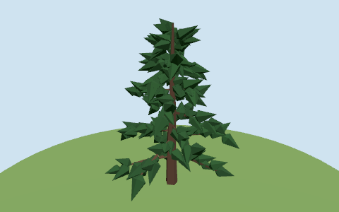 |
| [`examples/cdn`](examples/cdn/index.html) | `/examples/cdn/` | no bundler: a single HTML page with an import map | 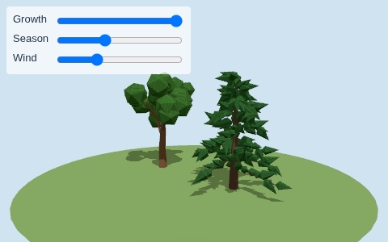 |
| [`examples/react`](examples/react/main.tsx) | `/examples/react/` | React Three Fiber: `<Tree>`, `<Wind>`, `useTreeStyle`; `?scene=forest` for `<Forest>`, `?scene=pipeline` for `<ScenePipeline>` | 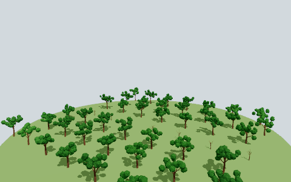 |
| [`examples/forest`](examples/forest/main.ts) | `/examples/forest/` | a 400-tree Forest; `?trees=&variants=&style=&season=` | 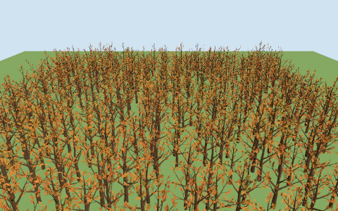 |
| [`examples/large-forest`](examples/large-forest/main.ts) | `/examples/large-forest/` | 10,000 trees with Detail Levels on and off: frame times, draw calls, triangles and trees per Detail Level; `?trees=&lod=0&frames=&orbit=` | 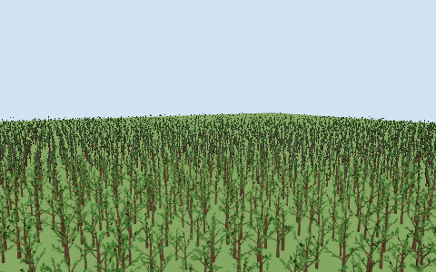 |
| [`examples/effects`](examples/effects/main.ts) | `/examples/effects/` | Tree Effects per Style; `?style=stylized&effects=outline` |  |
| [`examples/custom-effect`](examples/custom-effect/main.ts) | `/examples/custom-effect/` | a foliage-only [custom Tree Effect](#custom-tree-effects) (the bare setup); `?effect=on\|pass-through\|off&effects=style&view=mask&backend=webgl` | 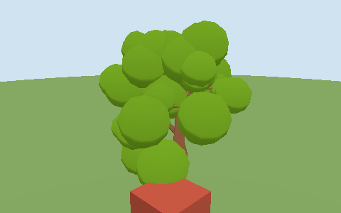 |
| [`examples/material-features`](examples/material-features/main.ts) | `/examples/material-features/` | the same tree with Material Features off and on (`SUGGESTED_MATERIAL_FEATURES`); `?style=realistic&species=oak` | 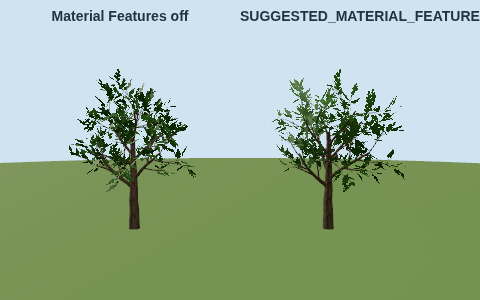 |
| [`examples/scene-pipeline`](examples/scene-pipeline/main.ts) | `/examples/scene-pipeline/` | the opt-in [Scene Pipeline](#scene-pipeline) (`createScenePipeline`) per Style: `?style=low-poly\|stylized\|realistic`; one Scene Effect alone through its builder: `?scene=tone-mapping\|smaa\|fxaa\|traa\|gtao\|bloom\|fog\|godrays\|motion-blur` (`&sun=back` for light shafts); `?scene=none` (adds nothing) or `plain` (`renderer.render`); the Wind-aware velocity channel: `?scene=velocity&wind=1.5&windTime=3`; motion blur: `?scene=motion-blur&wind=3&windTime=3&cameraStep=0.5`; `?backend=webgl` | 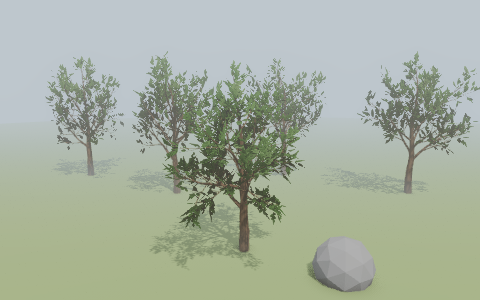 |
| [`examples/species`](examples/species/main.ts) | `/examples/species/` | a Species x Style picker over the whole collection; `?species=douglas-fir&style=realistic` |  |

```sh
npm install
npm run dev              # then open http://localhost:5173/examples/vanilla/ (or any example above)
npm run build:examples   # production build of the bundled examples -> examples/dist
```

The examples import the library by its package name (`@casmo/tree.js`), exactly like an app would; in this
repository that name resolves to the sources. The CDN example needs no build at all: copy
`examples/cdn/index.html` anywhere and open it over http(s). (The dev server rewrites its imports to the
sources too; the e2e test serves it unmodified, with the import map answered by the built `dist/`.)

## Development

`npm test` (Vitest), `npm run typecheck`, `npm run lint`, `npm run build` (library -> `dist/`),
`npm run test:e2e` (Playwright; run `npm run build` and `npm run build:examples` first, as CI does).
The Species gallery (`docs/species/`: images, contact sheet and page) is regenerated by `npm run gallery`
(Playwright, the e2e renderer; `npm run gallery -- oak birch` redoes only those Species).
The README's screenshots and GIFs (`docs/images/`) are rendered by `npm run readme-media`
(Playwright + ffmpeg; run `npm run build` first; `npm run readme-media -- wind hero` redoes only those).
Design decisions live in [`docs/adr`](docs/adr), the vocabulary in [`GLOSSARY.md`](GLOSSARY.md).

## License

MIT
