# Shader & post-processing concepts (temporary)

> **Not for merging.** These are quick visual sketches made to decide which features to build. Every effect here
> is a short hack in `concepts/main.ts`, not a proposed implementation. Delete this folder once the
> decisions are made.

Regenerate: `env -u DISPLAY node concepts/capture.mjs [concept ...]`. It uses headless Chromium, renders through
WebGPURenderer's WebGL2 fallback, and needs ffmpeg. The `env -u DISPLAY` is needed when `DISPLAY` points at an X
server the shell can't reach. In that case the GPU process fails and Chromium has no WebGL at all; the same happens
to `npm run readme-media`.

The concepts are grouped by **where they live**:

| Scope | Where it's implemented | Cost |
|---|---|---|
| **Per tree** | in the tree's node materials (Tree Definition / Style) | per-pixel shader math, no extra passes |
| **All trees** | Tree Effects: screen-space, masked to tree pixels | one post pass with the tree mask (MRT) |
| **Whole scene** | the app's post pipeline (three's TSL display nodes) | extra full-screen passes |

---

## 1. Per tree: material level

### Crown normals (spherical / bent normals)
**Industry standard** for stylized and realistic foliage (SpeedTree, Unreal and Unity foliage workflows).
The normal of each leaf is bent towards the normal of an ellipsoid around the crown, so the crown is lit as
one soft volume instead of a noise of cards.

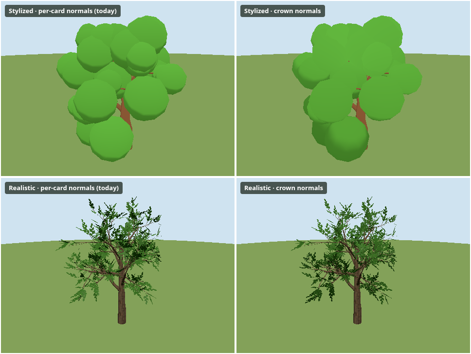

- Stylized: a big win, because the clumps read as one rounded crown.
- Realistic: the crown now has a real shadow side, which reads darker. It needs **translucency** and
  **AO** (below) next to it, and a lower blend (0.6 here) so some per-card detail stays.
- In the library: a `materials.leaf.crownNormals` amount (0..1). The crown ellipsoid (or several, one per
  cluster) is computed by the generator. It must keep working with Growth, Wind and Forest instancing.

### Leaf translucency (back-lit leaves)
**Industry standard** (SpeedTree "subsurface", UE "two-sided foliage"). When you look towards the sun through
the leaves they glow in their own colour, more at the thin edge of the crown.

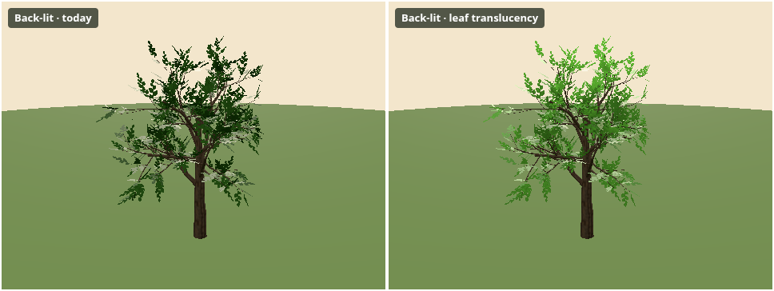

- A small term in the lighting model, the same hook as the `SoftToonLightingModel`. It could be done properly
  in `direct()` per light instead of this emissive hack.

### Structural AO (from the tree's own shape)
**Standard** in tree tools: SpeedTree bakes AO into vertex colours. Leaves deep inside the crown and the trunk
under it are darker. Free at runtime: no screen-space pass, stable, and it works on every renderer and in Baked Trees.

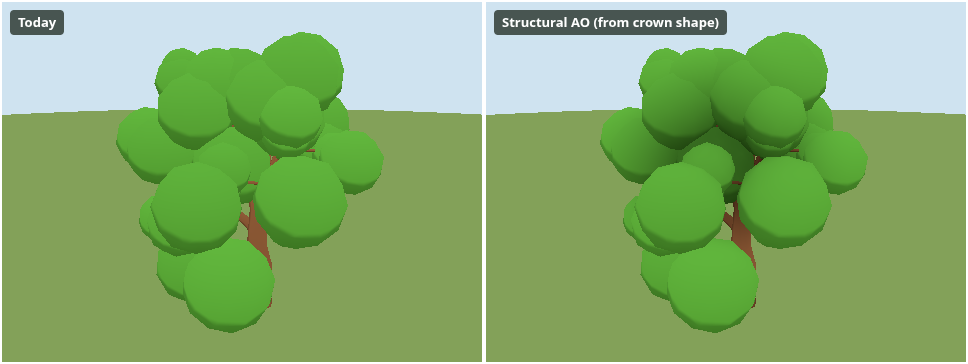

- Here it's computed from the distance to the crown centre. A real version could bake a per-vertex `aOcclusion`
  in the generator (e.g. by counting leaves above a point) and export it to glTF as vertex colours.

### Rim light (stylized)
**Common** in stylized games. A fresnel highlight on the crown silhouette. It only works on top of crown normals.

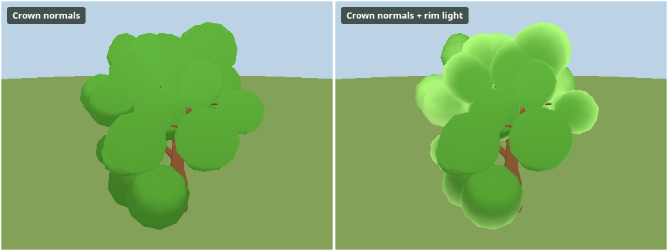

### Per-instance hue / brightness variation (Forest)
**Standard** ("hue variation" in SpeedTree and Unity terrain trees). Each Forest tree gets a small random hue and
brightness shift, so 4 Variants don't read as clones. Here it's seeded from the existing per-instance Wind phase,
so it needs no new attribute.

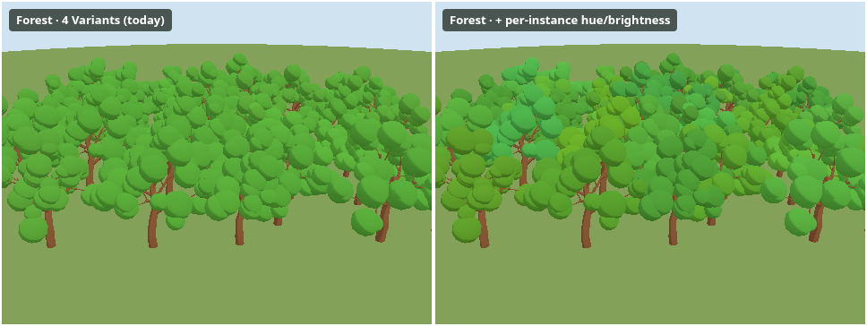

- Deliberately exaggerated here. A real version would be a `variation.hue` / `variation.brightness` range in the
  Tree Definition, so it stays deterministic per Seed.

### Alpha-to-coverage (leaf cards)
**Standard** for alpha-cut foliage with MSAA. Leaf edges get the MSAA sample coverage instead of a hard 1-bit cut.

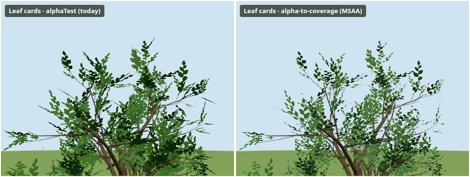

- The flag is one line (`material.alphaToCoverage = true`), but it only works with `antialias: true`.
- This also shows the classic side effect: leaves **thin out** because mipmaps average away the alpha.
  The industry fix is coverage-preserving mipmaps for the leaf textures (scale each mip's alpha to keep the same
  coverage), which `scripts/generate-textures.mjs` could do.

### LOD: dithered cross-fade and impostors
**Standard** for large forests. Distant trees switch to cheaper meshes and finally to an **impostor**, a
camera-facing quad with a pre-rendered image (octahedral atlases in UE and Unity). The switch is hidden by a
**screen-space dither cross-fade** (no transparency sorting).

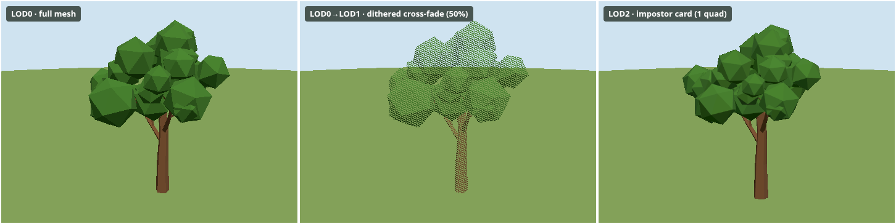

- The impostor here is one view baked into a texture at runtime. A real one bakes an octahedral grid of views
  (plus normals, so it can still be lit). Season changes the leaf colour, so impostors would need re-baking or a
  tint mask.

---

## 2. All trees: Tree Effects (tree mask)

### Per-tree ID in the mask
Today the mask can tell *tree* from *not tree*, but not *which* tree, so the outline only goes around the union of
all trees. A per-tree ID (one more MRT channel) gives lines **between** overlapping trees.

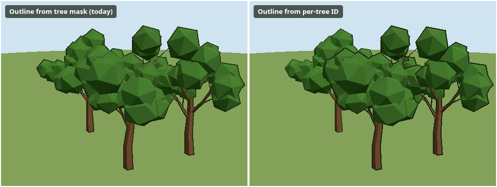

### Hover / selection highlight
The same ID makes picking feedback easy: highlight one tree and outline only its outside. Useful for the Tree
Editor, games and city-builders.

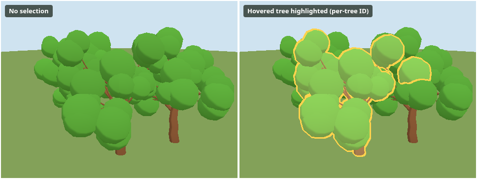

### Inner lines (depth and normal edges)
**Common** in toon and low-poly looks (the "Moebius" or ink style). Edges are found in the depth and normal
buffers, inside the tree mask only, so each leaf clump gets its own ink line, not only the silhouette.

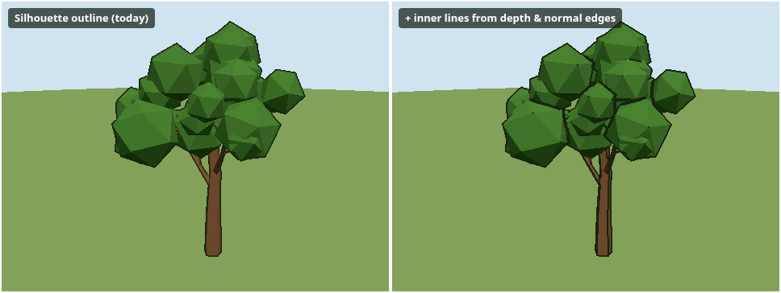

### Season-driven grade
The existing tree colour grade, with its settings keyframed against Season (e.g. warmer and lower contrast in
autumn), like the Season Profile. Small and on-brand, but the grade needs gentle values: autumn colours clip easily.

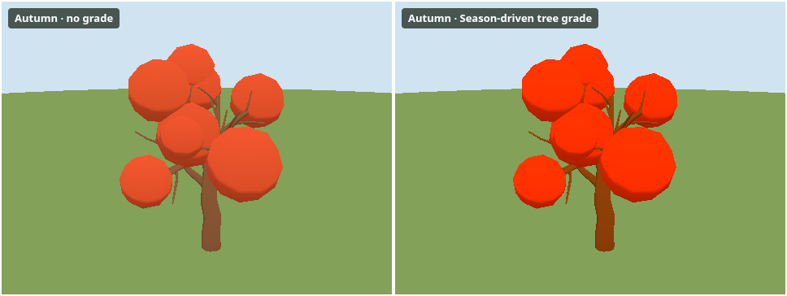

---

## 3. Whole scene: standard post stack (three's built-in TSL nodes)

The library shouldn't own these. They belong to the app. But a **suggested pipeline per Style** (like
`SUGGESTED_TREE_EFFECTS`) plus an example would show trees at their best. Everything below is already in
`three/addons/tsl/display/`.

### Tone mapping (baseline, every engine)
Set on the renderer. **AgX** and **Neutral** are today's defaults in Blender and in glTF/Khronos PBR. ACES
desaturates and shifts greens towards yellow, which matters a lot for foliage.

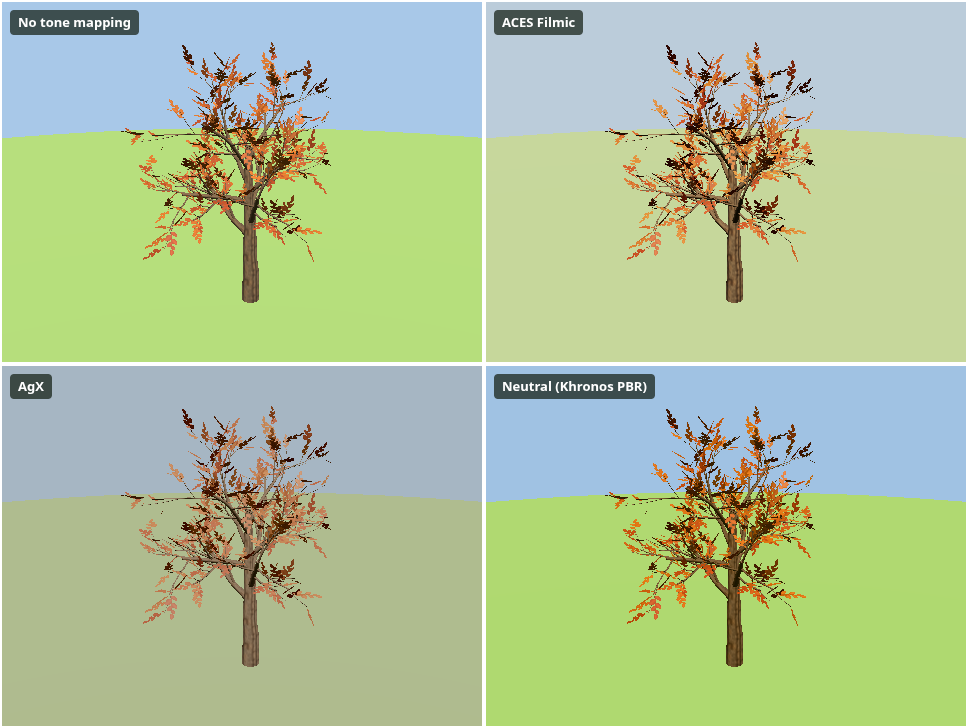

### Anti-aliasing (baseline)
The low-poly facets and leaf cards alias badly without it. FXAA is cheap but soft, SMAA is sharper. TRAA
(temporal) is the modern standard and also smooths alpha-cut leaves, but it needs a velocity MRT and blurs a
bit while Wind is moving. Shown at 2× so the pixels are visible.

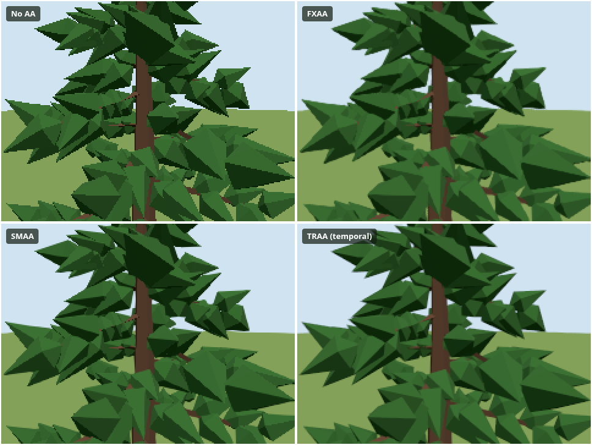

### Bloom (baseline)
HDR glare from bright areas, here an HDR sun disc seen through the crown.

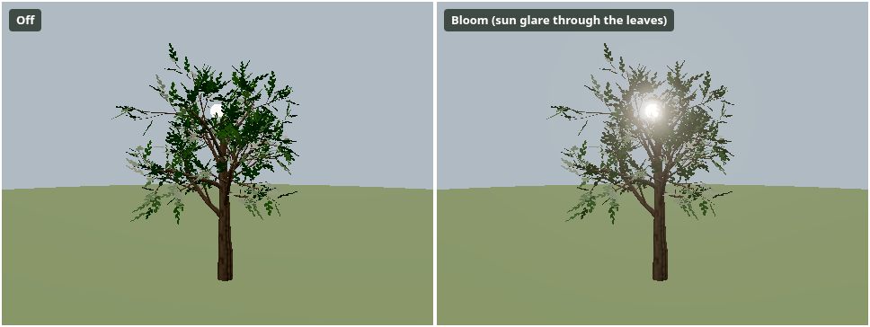

### GTAO (screen-space ambient occlusion)
The standard AO pass. It complements structural AO: GTAO catches contact with the ground and with other
objects, while structural AO covers the inside of the crown, which GTAO can't see.

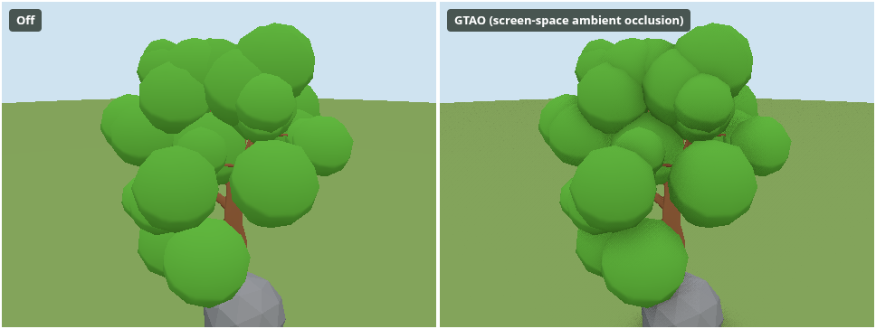

### 3D LUT colour grade (baseline in every engine)
The final look of the whole frame from one 3D texture (exported from DaVinci Resolve, Photoshop and so on).
The LUT here is generated in code: warm highlights, teal lifted shadows.

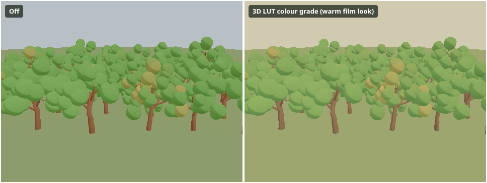

### God rays (volumetric light shafts)
**Very typical for forests.** It needs real shadows (renderer shadow map, trees casting). Uses `GodraysNode`
plus `depthAwareBlend`.

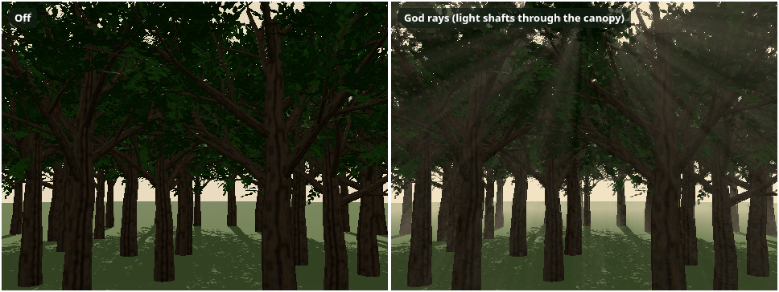

### Depth of field
**Common** for showcases, product shots and the Tree Editor's thumbnails.

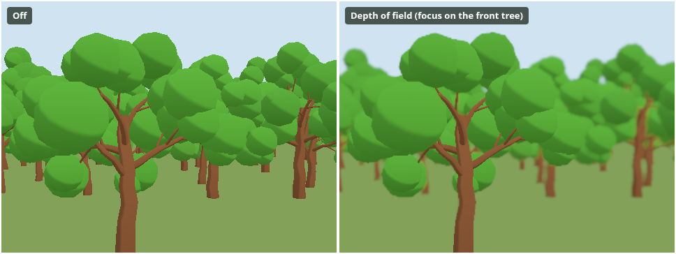

### Fog: distance and height
Built into three (`scene.fog` / `scene.fogNode`). **Height fog** (mist in the low parts) is the standard way
to give forests depth.

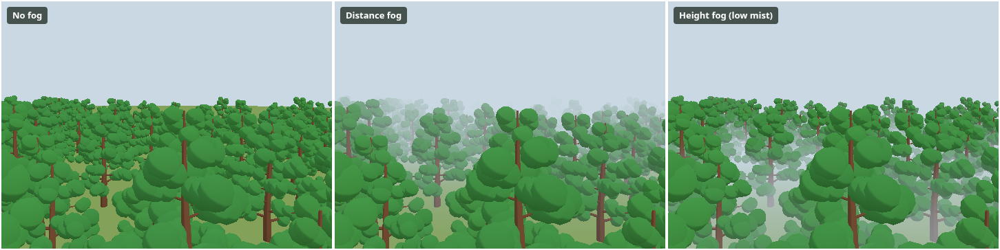

### Contact shadows (screen-space shadows)
Small sharp shadows that a coarse shadow map misses (big worlds use coarse cascades). Noisy without the
recommended blur, and less important for trees than the others.

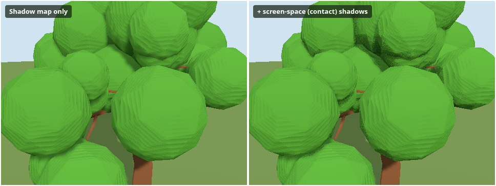

### Stylized full-screen looks
All built into three: pixelation with depth/normal edges, PS1-style retro, film grain, and Sobel edges used as
ink lines. These could pair with Styles (pixel-art Style + pixelation pass, for example).

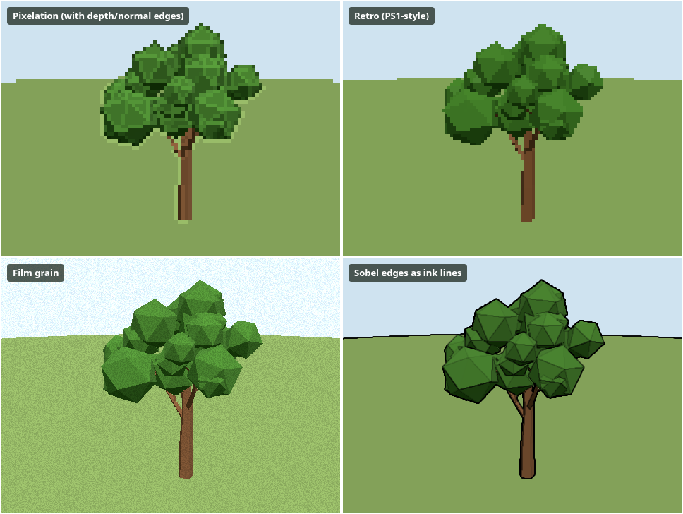

---

## Not shown
- **SSGI** (screen-space global illumination, `SSGINode`): green bounce light from the canopy onto the trunk and
  ground. It's expensive and needs temporal denoising.
- **Wind-aware TRAA / motion blur**: needs Wind to output velocity (positionNode differences per frame).
