# Painterly concepts (temporary, not for merge)

Throwaway concept renders for the Painterly Style (#108, ticket #109): different ways to draw Painterly
**Leaf Masses** (A–D) and conifer **Tiers**, side by side, so the owner can pick one. Every concept is a quick
hack in `concepts/main.ts`, not a proposed implementation.

- Page: `npm run dev`, then `/concepts/?c=<concept>&v=<variant>&view=<0 tycoon | 1 top-down | 2 3/4>`.
  Concepts: `current`, `A`, `B`, `C`, `D`, `tier`, and (round 2, B and D only) `B-more`, `D-more`, `BD`,
  `saturation`, `species-B`, `species-D`, `grove`.
- Images: `env -u DISPLAY node concepts/capture.mjs [concept ...]` (headless Chromium, SwiftShader / WebGL2
  fallback, needs ffmpeg). Writes `concepts/images/<concept>.png` (rows = strength variants, columns = tycoon
  55°, top-down 90°, 3/4 20°) and `overview.png` (one tycoon pane per concept).
  `node concepts/capture.mjs A:1@2` renders one pane (variant 1, view 2) to `/tmp`.

Scene: oak, birch and pine (Seed 3, Season 0.37) in a small cluster on flat grass-coloured ground, one warm
sun (with shadows) and a hemisphere sky light, no Tree Effects or Scene Effects except C's own. All trees,
the current looks too, are scaled to Painterly heights (oak 3.0 m, birch 3.4 m, pine 3.8 m; ADR 0013).
The wood is the stylized wood mesh with a painted bark texture. Leaf Masses come from k-means over the leaf
positions of the realistic look (a dense sample of the Species' crown), so the crown shape stays the Species'.

All concepts share one **painted lighting model** (soft wrap diffuse, no bands, no specular) and one
**painted gradient**: a ramp deep cool green -> leaf colour -> warm yellow-green, driven per pixel by height in
the crown, how much the (bent) normal faces up and towards the sun, an occlusion term baked per vertex (inside
other masses, near the trunk, low in the crown) and the painted texture's value. "gradient" in the labels is
the ramp's contrast, "texture" how strongly the painted texture shifts it.

| Concept | What it is | Cost (per tree) |
|---|---|---|
| **A** | one lumpy icosphere per Leaf Mass (4–6 per crown), a tileable painted leaf texture projected triplanar in world space, a noise / leaf-coverage alpha cut near the silhouette (front faces only, so the edge shows what is behind) | ~500 triangles per mass (~2.5–3k per tree), 1 draw |
| **B** | A's core (shrunk to 86 %) plus a shell of jagged painted spray cards on its surface, card normals = the mass ellipsoid normal | core + 40–110 cards per mass |
| **C** | A + a circular Kuwahara filter as a custom Tree Effect (`createTreeEffects` + `addEffect`), only on tree pixels | A + one post pass (21–97 taps per pixel) |
| **D** | cards only: 110–220 painted spray cards per clump (more, smaller clumps), filling the clump volume, normals bent to the clump | 2 triangles per card, 1 draw |
| **Tier** | per first-level conifer branch one drooping, cupped fan mesh (10×7 quads) as long as the branch's needles reach, alpha cut by a ragged painted needle texture, normals bent up/outward; only the trunk is kept as wood | ~140 triangles per branch |

## Images

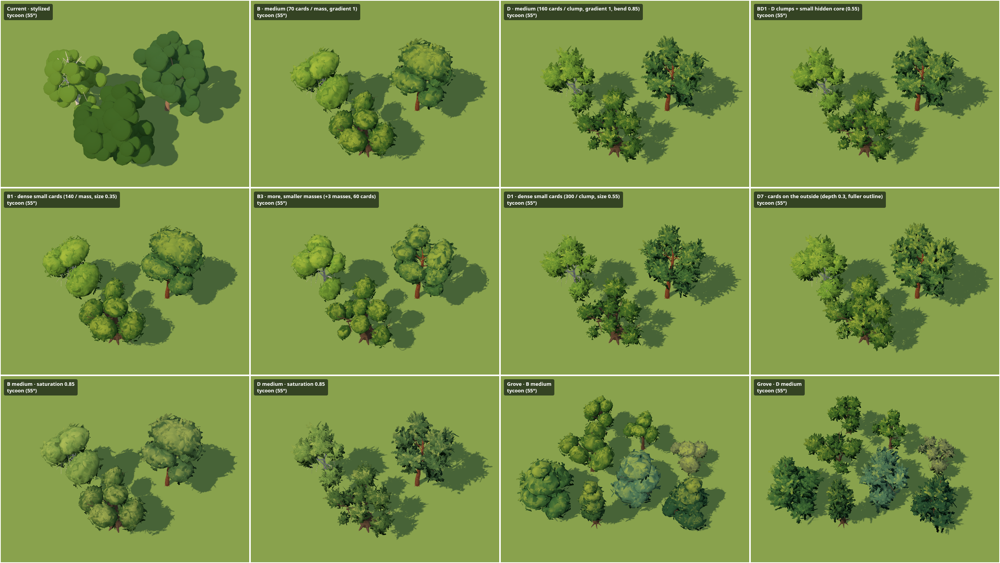
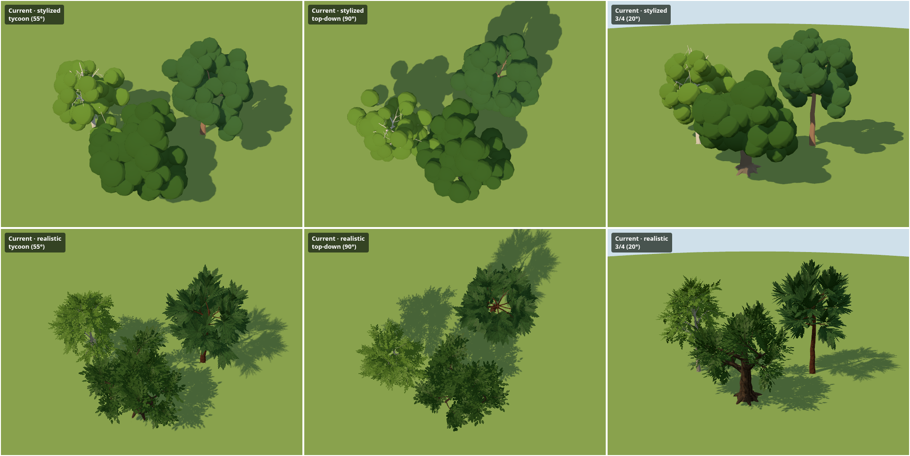
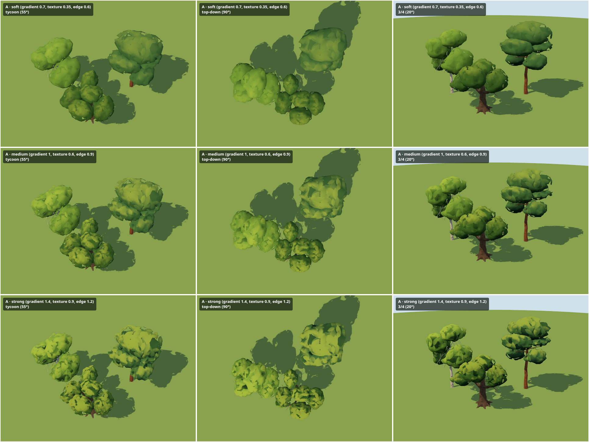
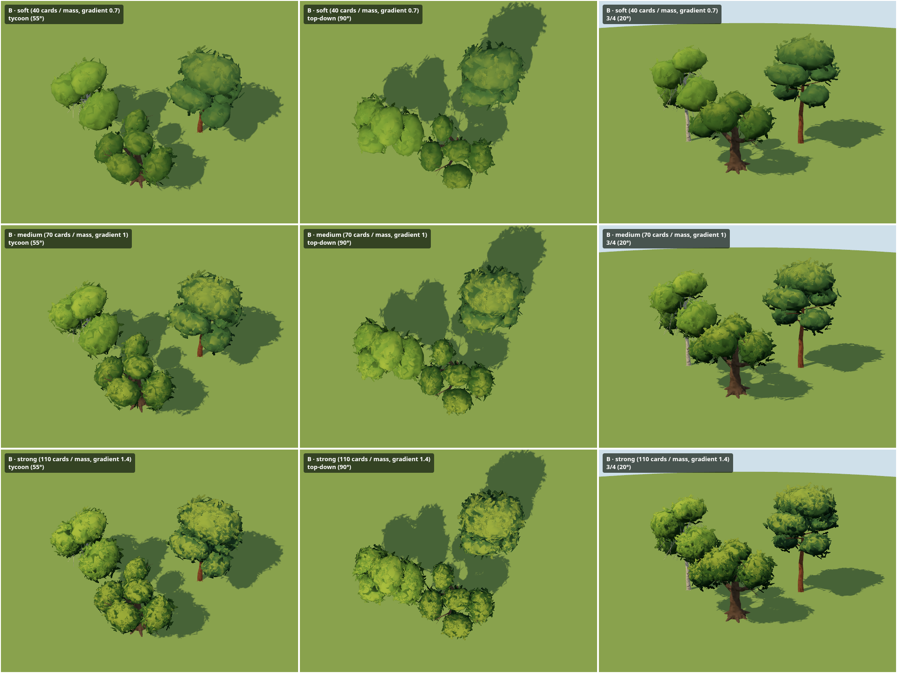
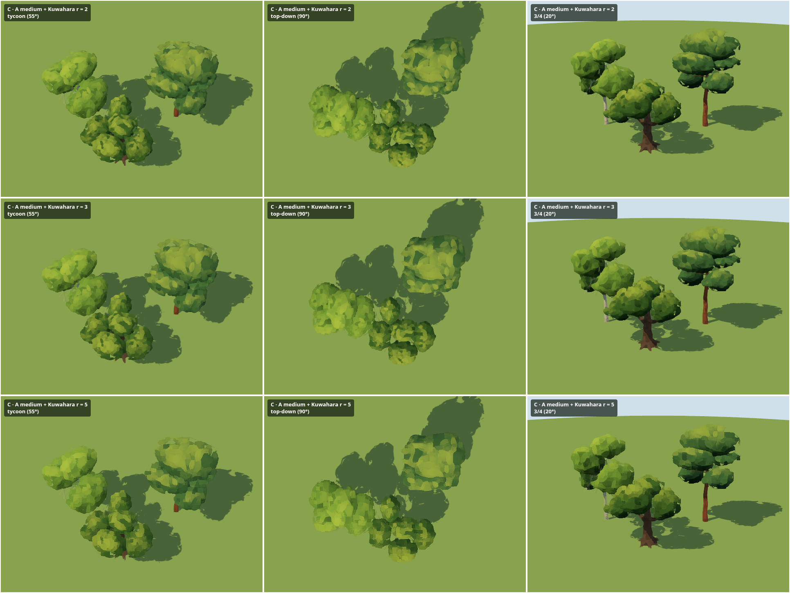
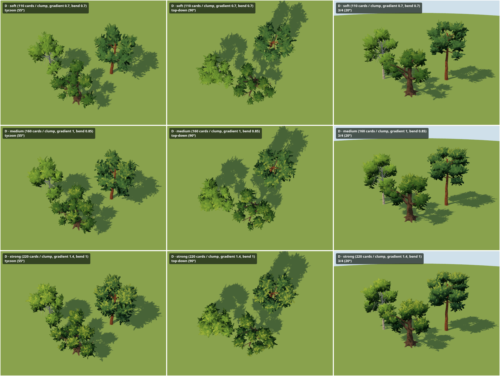
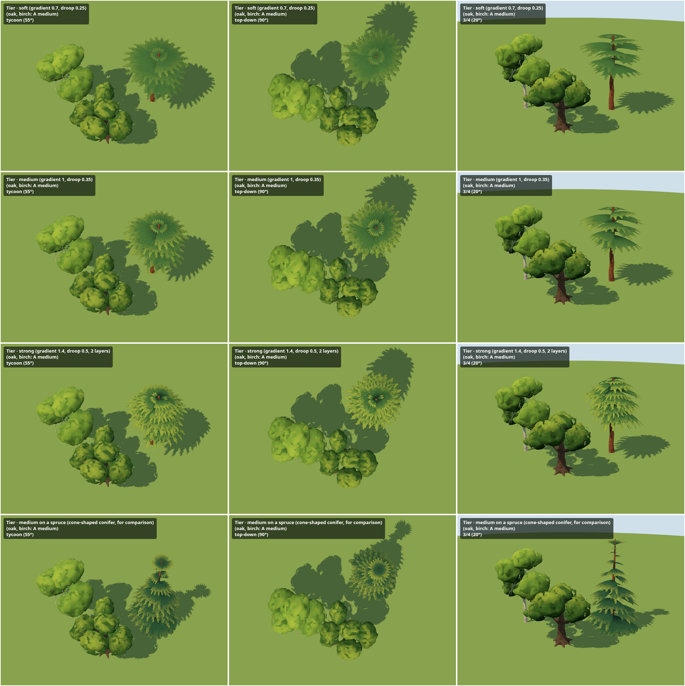

## Round 2: more B and D (owner picked B and D)

Every variant has a short name the owner can pick by (B1, D3, BD2, ...). Unless listed, settings are "medium".

- **B-more** (oak/birch/pine): B1 dense small cards (140 / mass, size 0.35) · B2 sparse big cards (30, size 0.75) ·
  B3 more, smaller masses (+3) · B4 fewer, bigger masses (-2) · B5 flat gradient (0.5) · B6 bold gradient (1.7).
- **D-more**: D1 dense small cards (300 / clump, size 0.55) · D2 sparse big cards (80, size 1.1) · D3 few clumps
  (Species count) · D4 many small clumps (+7) · D5 flat gradient (0.5) · D6 bold gradient (1.7, bend 1) ·
  D7 cards on the outside (depth 0.3: fuller outline, less wood showing).
- **BD** hybrids: BD1 D clumps + small hidden core (0.55, fills D's holes) · BD2 B masses + deep D cards (core 0.7,
  depth 0.5, size 0.65) · BD3 in-between (+1 mass, core 0.75, depth 0.3, size 0.6).
- **saturation**: B medium and D medium at saturation 1 / 0.85 / 0.7 (leaf palette and bark mixed towards their
  luminance; ground unchanged).
- **species-B / species-D**: one tree per row, B medium / D medium: maple 3.4, cherry 3.1, olive 2.6, elm 3.5,
  cedar 3.4, spruce 3.6, Douglas fir 3.8, redwood 4.0 m (camera fitted to the tree).
- **grove**: all eight together, B and D medium at saturation 1 / 0.85 / 0.7.

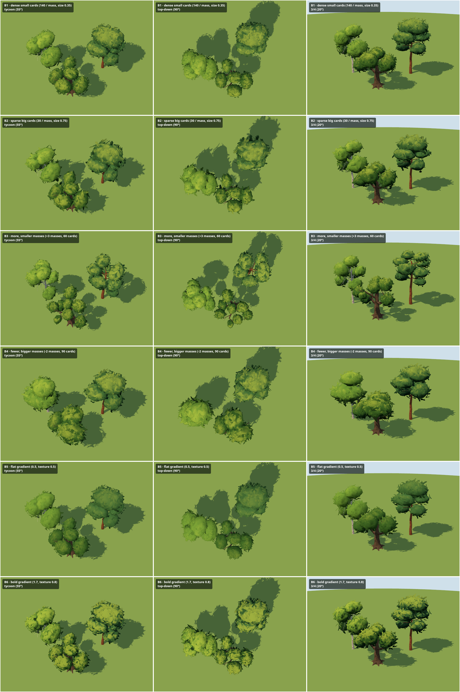
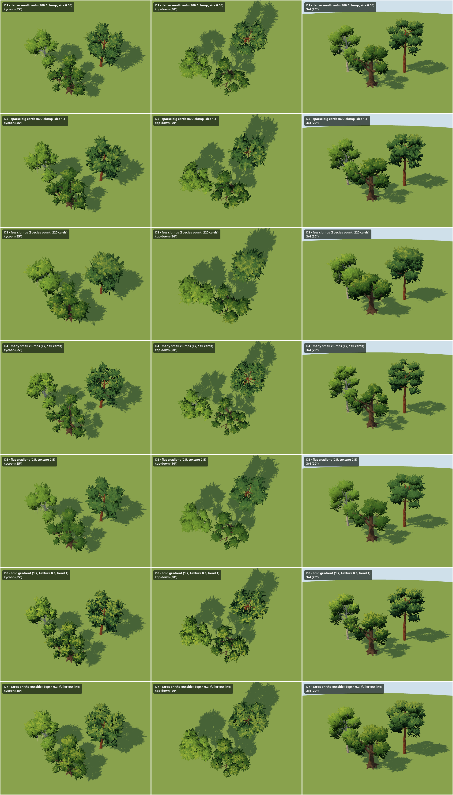
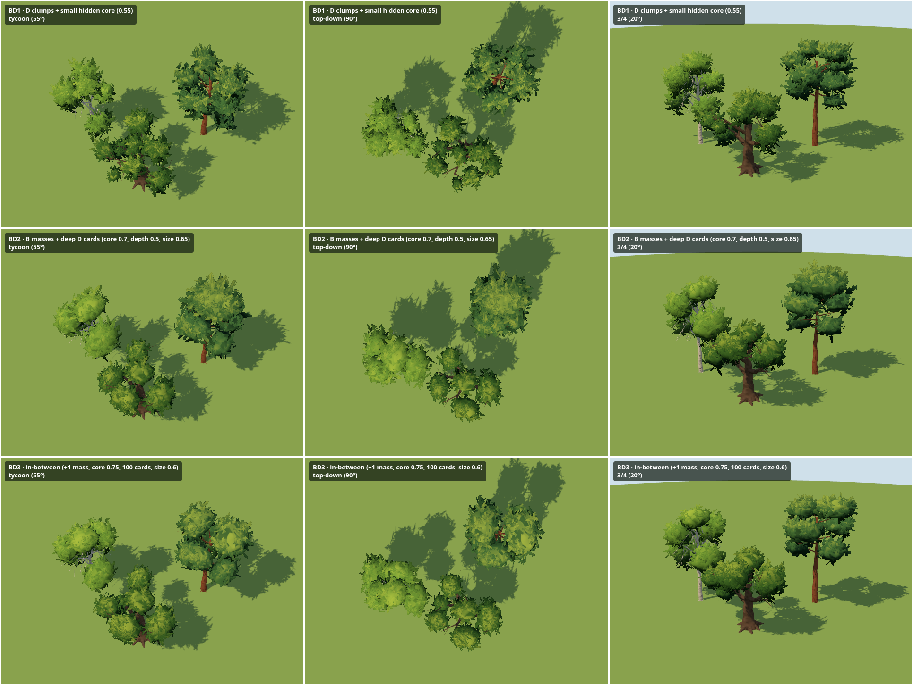
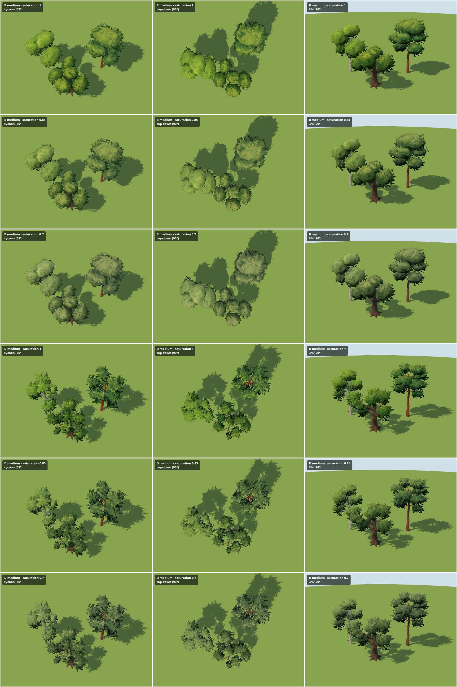
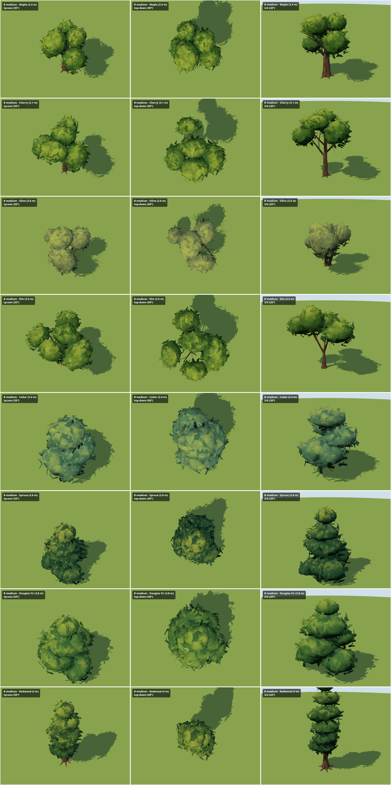
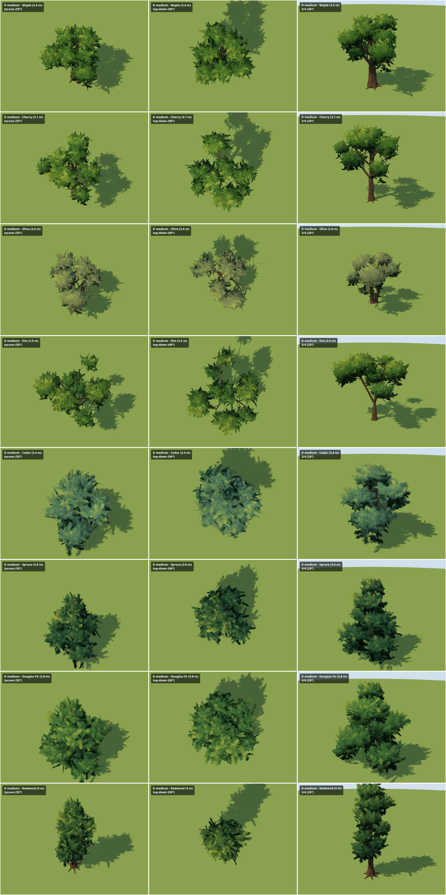
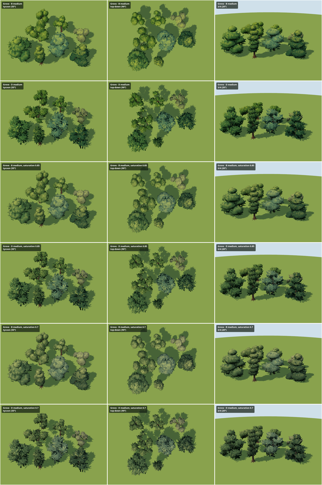

## Notes per concept

- **A**: cheapest and most stable (one closed mesh, no sorting, no card noise); reads clearly as a few chunky
  masses from every view. The silhouette is only a little ragged (the cut is limited to grazing angles) and the
  masses can look like soft "cauliflower" blobs at low texture strength.
- **B**: the jagged card fringe gives the ragged, leafy edge of the references while the core keeps the shape
  and the gradient; the best match of the three mesh routes in our eyes. More triangles and alpha-tested
  overdraw than A.
- **C**: the filter does make it look painted, but it is resolution dependent (a radius in pixels), blurs the
  bark too, costs a full-screen pass, and goes blocky at large radii. It would make Painterly need post
  (against the ADR 0008 / 0010 default).
- **D**: closest to the "spray cards" asset packs, looks lively and believable, but is the busiest from above
  and lets the wood show through; the most like 'realistic'.
- **Tier**: reads as stacked, drooping conifer layers in 3/4 (very close to the pine references on a
  cone-shaped spruce), but on the Scots-pine Species (high, flat crown) it looks like stacked umbrellas, and
  from straight above the fans form a radial "sunburst" disc.

Textures here are drawn at runtime on a canvas with the seeded `createRandom`; the real Style would bake them in
`scripts/generate-textures.mjs` (`painterly/` next to `realistic/`).
