# Species gallery

<!-- GENERATED by scripts/render-gallery.mjs (`npm run gallery`); do not edit by hand. -->

All 28 Species of `@casmo/tree.js/species` in the built-in Styles low-poly, stylized, realistic, painterly, whimsical (Seed 1, summer = Season 0.37),
plus a shot with ripe Fruit for Species with seasonal Fruit and an autumn shot for the deciduous broadleaves. Each Species is
plain JSON; any Style turns it into a Tree Definition: `createTree(lowPoly.apply(oak), { seed: 1 })`.
Images are rendered by `npm run gallery` with the same renderer as the e2e tests (SwiftShader WebGPU).
Try them live in [`examples/species`](../../examples/species/main.ts) or start from one in the Tree Editor.

- **Broadleaf**: [Almond](#almond) · [Apple](#apple) · [Ash](#ash) · [Beech](#beech) · [Birch](#birch) · [Cherry](#cherry) · [Chestnut](#chestnut) · [Elm](#elm) · [Hickory](#hickory) · [Mahogany](#mahogany) · [Maple](#maple) · [Oak](#oak) · [Olive](#olive) · [Peach](#peach) · [Pear](#pear) · [Plum](#plum) · [Red Oak](#red-oak) · [Teak](#teak) · [Walnut](#walnut) · [White Oak](#white-oak)
- **Conifer**: [Cedar](#cedar) · [Douglas Fir](#douglas-fir) · [Hemlock](#hemlock) · [Juniper](#juniper) · [Pine](#pine) · [Redwood](#redwood) · [Sequoia](#sequoia) · [Spruce](#spruce)

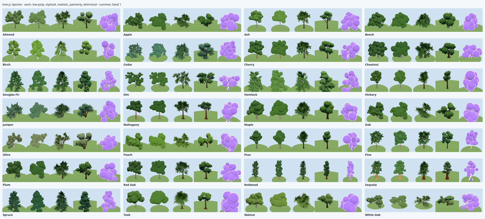

## Almond

`almond` · broadleaf · broad leaves · furrowed bark · Fruit: nut · [almond.json](../../src/species/data/almond.json)

| | low-poly | stylized | realistic | painterly | whimsical |
| --- | --- | --- | --- | --- | --- |
| summer | 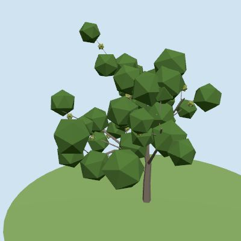 |  |  | 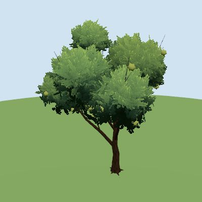 | 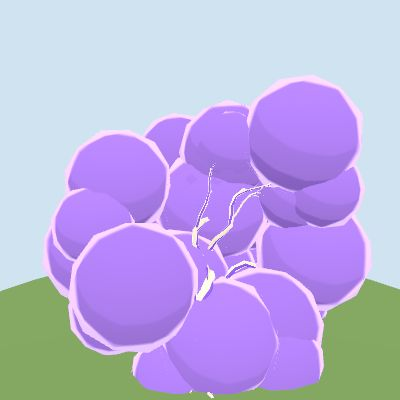 |
| with Fruit | 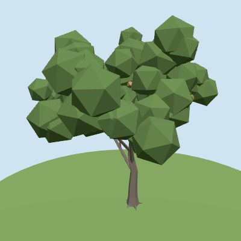 |  | 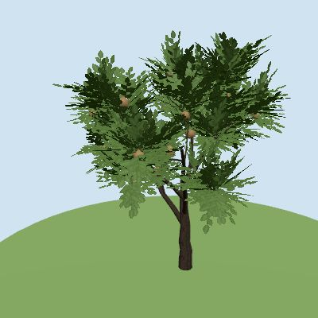 | 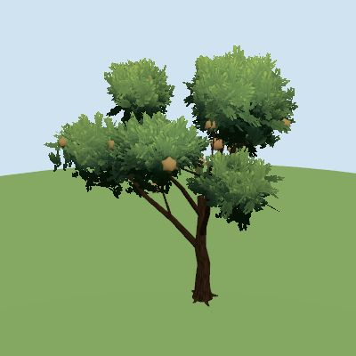 | 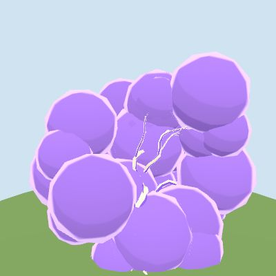 |
| autumn | 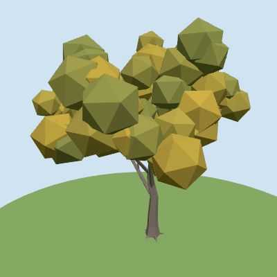 | 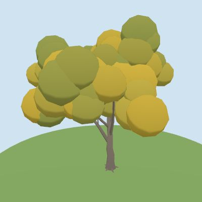 | 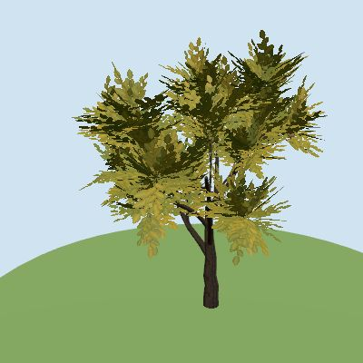 | 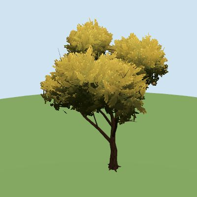 | 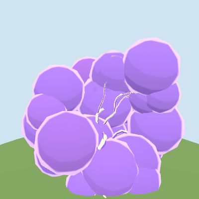 |

```ts
import { createTree } from '@casmo/tree.js';
import { almond } from '@casmo/tree.js/species';
import lowPoly from '@casmo/tree.js/styles/low-poly';

const tree = createTree(lowPoly.apply(almond), { seed: 1 });
```

## Apple

`apple` · broadleaf · broad leaves · furrowed bark · Fruit: round · [apple.json](../../src/species/data/apple.json)

| | low-poly | stylized | realistic | painterly | whimsical |
| --- | --- | --- | --- | --- | --- |
| summer | 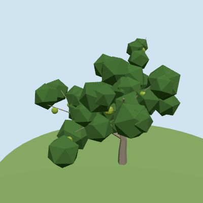 | 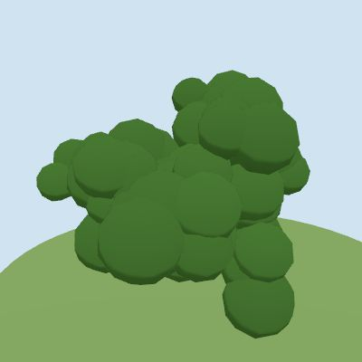 | 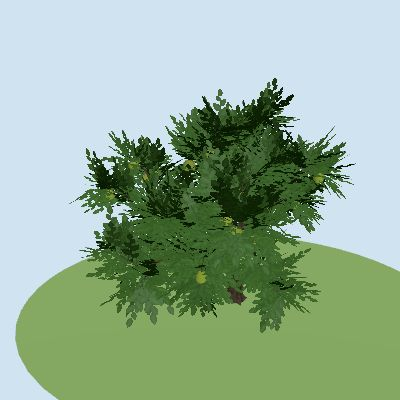 | 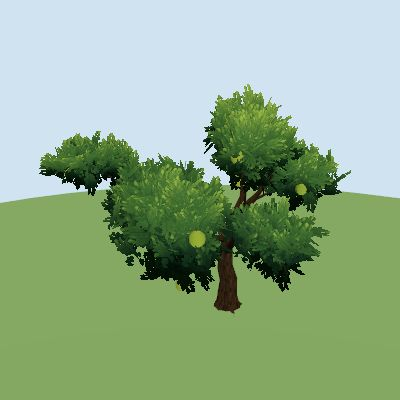 | 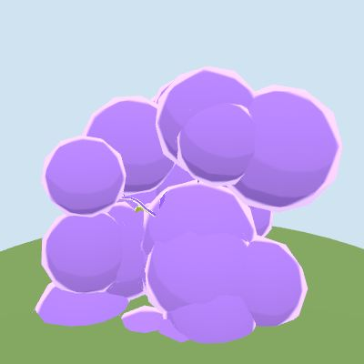 |
| with Fruit | 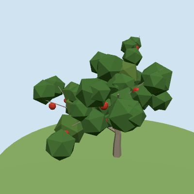 |  | 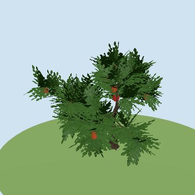 | 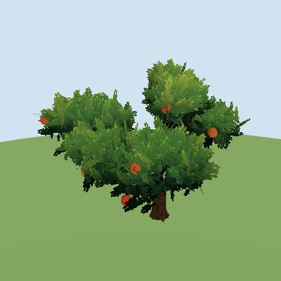 |  |
| autumn | 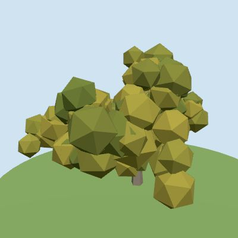 | 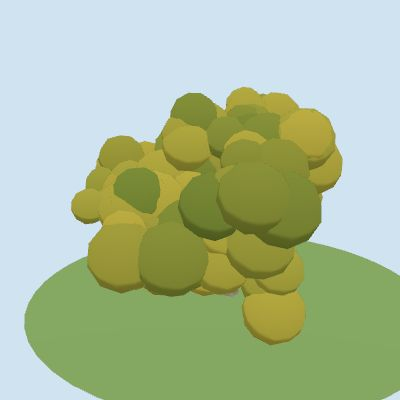 | 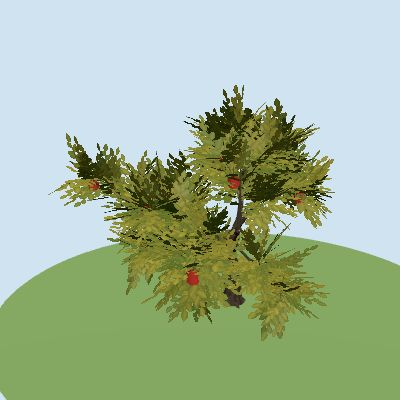 | 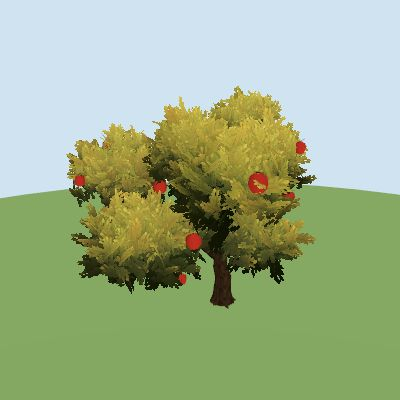 | 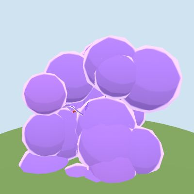 |

```ts
import { createTree } from '@casmo/tree.js';
import { apple } from '@casmo/tree.js/species';
import lowPoly from '@casmo/tree.js/styles/low-poly';

const tree = createTree(lowPoly.apply(apple), { seed: 1 });
```

## Ash

`ash` · broadleaf · compound leaves · furrowed bark · [ash.json](../../src/species/data/ash.json)

| | low-poly | stylized | realistic | painterly | whimsical |
| --- | --- | --- | --- | --- | --- |
| summer | 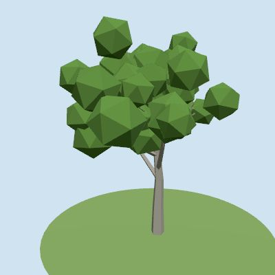 |  | 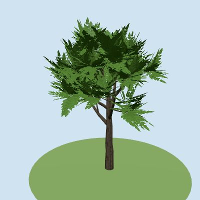 | 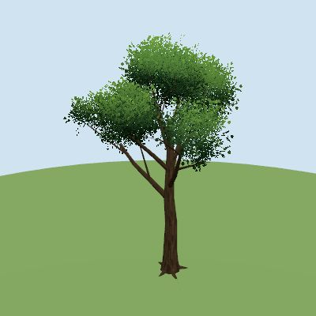 | 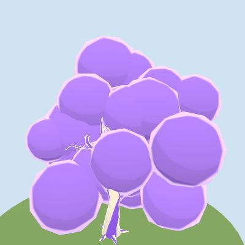 |
| autumn | 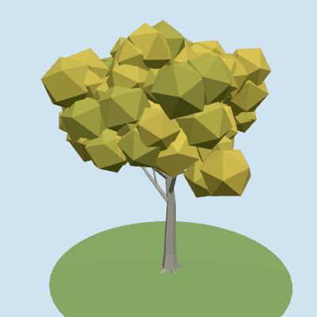 | 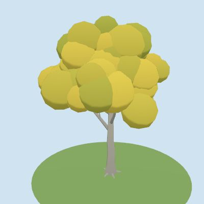 | 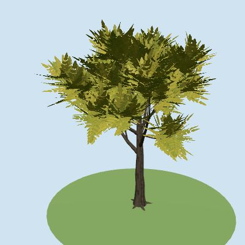 | 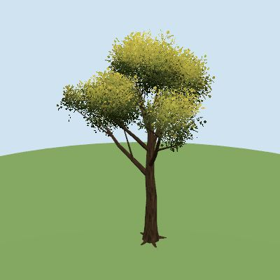 | 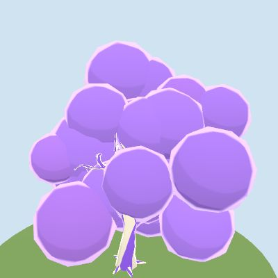 |

```ts
import { createTree } from '@casmo/tree.js';
import { ash } from '@casmo/tree.js/species';
import lowPoly from '@casmo/tree.js/styles/low-poly';

const tree = createTree(lowPoly.apply(ash), { seed: 1 });
```

## Beech

`beech` · broadleaf · broad leaves · smooth bark · [beech.json](../../src/species/data/beech.json)

| | low-poly | stylized | realistic | painterly | whimsical |
| --- | --- | --- | --- | --- | --- |
| summer | 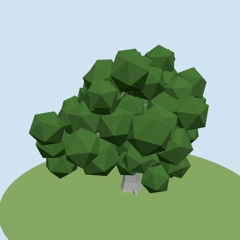 | 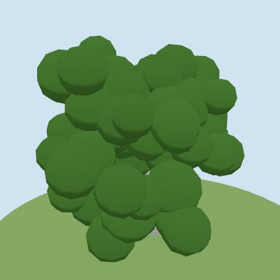 | 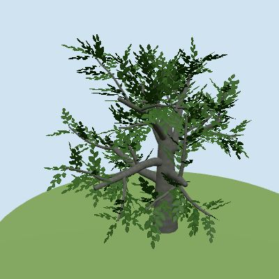 | 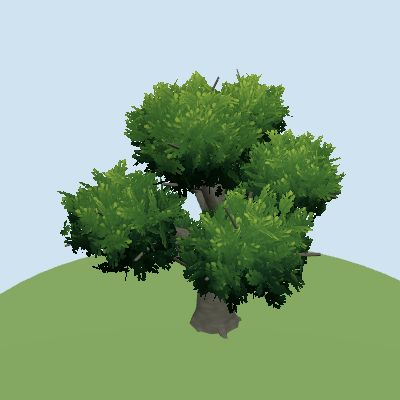 | 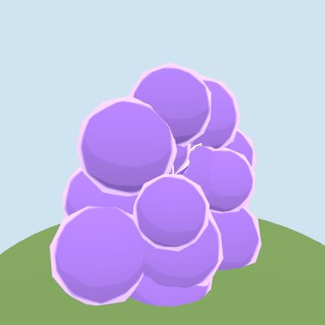 |
| autumn | 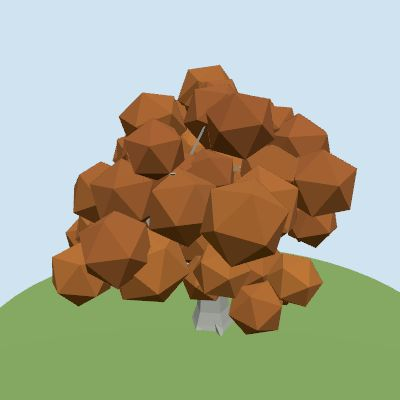 | 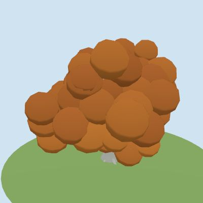 | 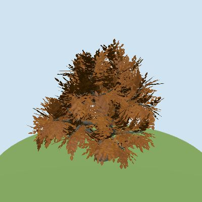 | 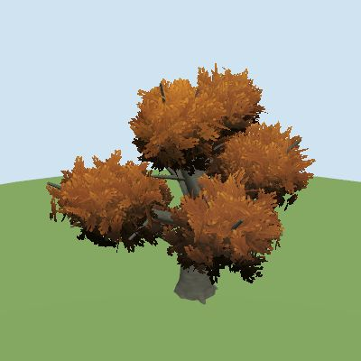 |  |

```ts
import { createTree } from '@casmo/tree.js';
import { beech } from '@casmo/tree.js/species';
import lowPoly from '@casmo/tree.js/styles/low-poly';

const tree = createTree(lowPoly.apply(beech), { seed: 1 });
```

## Birch

`birch` · broadleaf · broad leaves · papery bark · [birch.json](../../src/species/data/birch.json)

| | low-poly | stylized | realistic | painterly | whimsical |
| --- | --- | --- | --- | --- | --- |
| summer | 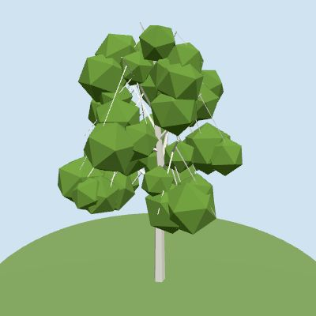 | 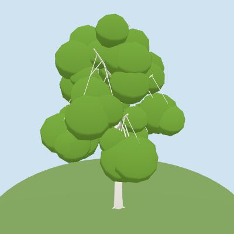 | 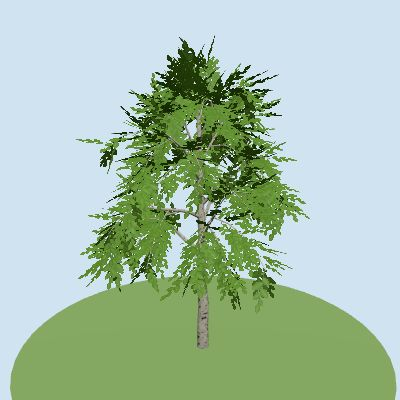 | 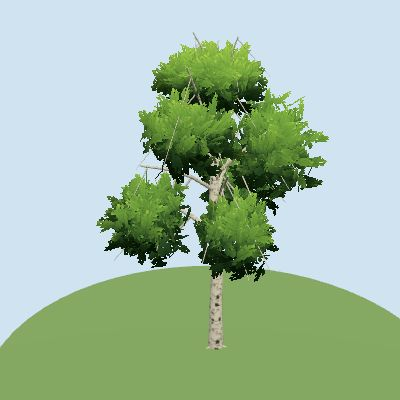 | 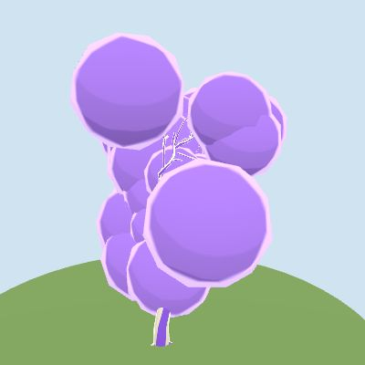 |
| autumn | 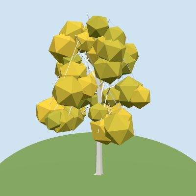 |  |  |  |  |

```ts
import { createTree } from '@casmo/tree.js';
import { birch } from '@casmo/tree.js/species';
import lowPoly from '@casmo/tree.js/styles/low-poly';

const tree = createTree(lowPoly.apply(birch), { seed: 1 });
```

## Cedar

`cedar` · conifer · scale leaves · fibrous bark · Fruit: cone · 2 Stems · [cedar.json](../../src/species/data/cedar.json)

| | low-poly | stylized | realistic | painterly | whimsical |
| --- | --- | --- | --- | --- | --- |
| summer |  |  |  |  |  |

```ts
import { createTree } from '@casmo/tree.js';
import { cedar } from '@casmo/tree.js/species';
import lowPoly from '@casmo/tree.js/styles/low-poly';

const tree = createTree(lowPoly.apply(cedar), { seed: 1 });
```

## Cherry

`cherry` · broadleaf · broad leaves · smooth bark · Fruit: round · [cherry.json](../../src/species/data/cherry.json)

| | low-poly | stylized | realistic | painterly | whimsical |
| --- | --- | --- | --- | --- | --- |
| summer |  |  |  |  |  |
| with Fruit |  |  |  |  |  |
| autumn |  |  |  |  |  |

```ts
import { createTree } from '@casmo/tree.js';
import { cherry } from '@casmo/tree.js/species';
import lowPoly from '@casmo/tree.js/styles/low-poly';

const tree = createTree(lowPoly.apply(cherry), { seed: 1 });
```

## Chestnut

`chestnut` · broadleaf · broad leaves · furrowed bark · Fruit: nut · Roots · [chestnut.json](../../src/species/data/chestnut.json)

| | low-poly | stylized | realistic | painterly | whimsical |
| --- | --- | --- | --- | --- | --- |
| summer |  |  |  |  |  |
| with Fruit |  |  |  |  |  |
| autumn |  |  |  |  |  |

```ts
import { createTree } from '@casmo/tree.js';
import { chestnut } from '@casmo/tree.js/species';
import lowPoly from '@casmo/tree.js/styles/low-poly';

const tree = createTree(lowPoly.apply(chestnut), { seed: 1 });
```

## Douglas Fir

`douglasFir` · conifer · needle leaves · furrowed bark · Fruit: cone · [douglas-fir.json](../../src/species/data/douglas-fir.json)

| | low-poly | stylized | realistic | painterly | whimsical |
| --- | --- | --- | --- | --- | --- |
| summer |  |  |  |  |  |

```ts
import { createTree } from '@casmo/tree.js';
import { douglasFir } from '@casmo/tree.js/species';
import lowPoly from '@casmo/tree.js/styles/low-poly';

const tree = createTree(lowPoly.apply(douglasFir), { seed: 1 });
```

## Elm

`elm` · broadleaf · broad leaves · furrowed bark · [elm.json](../../src/species/data/elm.json)

| | low-poly | stylized | realistic | painterly | whimsical |
| --- | --- | --- | --- | --- | --- |
| summer |  |  |  |  |  |
| autumn |  |  |  |  |  |

```ts
import { createTree } from '@casmo/tree.js';
import { elm } from '@casmo/tree.js/species';
import lowPoly from '@casmo/tree.js/styles/low-poly';

const tree = createTree(lowPoly.apply(elm), { seed: 1 });
```

## Hemlock

`hemlock` · conifer · needle leaves · furrowed bark · Fruit: cone · [hemlock.json](../../src/species/data/hemlock.json)

| | low-poly | stylized | realistic | painterly | whimsical |
| --- | --- | --- | --- | --- | --- |
| summer |  |  |  |  |  |

```ts
import { createTree } from '@casmo/tree.js';
import { hemlock } from '@casmo/tree.js/species';
import lowPoly from '@casmo/tree.js/styles/low-poly';

const tree = createTree(lowPoly.apply(hemlock), { seed: 1 });
```

## Hickory

`hickory` · broadleaf · compound leaves · fibrous bark · Fruit: nut · [hickory.json](../../src/species/data/hickory.json)

| | low-poly | stylized | realistic | painterly | whimsical |
| --- | --- | --- | --- | --- | --- |
| summer |  |  |  |  |  |
| with Fruit |  |  |  |  |  |
| autumn |  |  |  |  |  |

```ts
import { createTree } from '@casmo/tree.js';
import { hickory } from '@casmo/tree.js/species';
import lowPoly from '@casmo/tree.js/styles/low-poly';

const tree = createTree(lowPoly.apply(hickory), { seed: 1 });
```

## Juniper

`juniper` · conifer · scale leaves · fibrous bark · Fruit: berry · 3 Stems · [juniper.json](../../src/species/data/juniper.json)

| | low-poly | stylized | realistic | painterly | whimsical |
| --- | --- | --- | --- | --- | --- |
| summer |  |  |  |  |  |

```ts
import { createTree } from '@casmo/tree.js';
import { juniper } from '@casmo/tree.js/species';
import lowPoly from '@casmo/tree.js/styles/low-poly';

const tree = createTree(lowPoly.apply(juniper), { seed: 1 });
```

## Mahogany

`mahogany` · broadleaf · compound leaves · plated bark · Fruit: pear · Roots · [mahogany.json](../../src/species/data/mahogany.json)

| | low-poly | stylized | realistic | painterly | whimsical |
| --- | --- | --- | --- | --- | --- |
| summer |  |  |  |  |  |
| with Fruit |  |  |  |  |  |

```ts
import { createTree } from '@casmo/tree.js';
import { mahogany } from '@casmo/tree.js/species';
import lowPoly from '@casmo/tree.js/styles/low-poly';

const tree = createTree(lowPoly.apply(mahogany), { seed: 1 });
```

## Maple

`maple` · broadleaf · palmate leaves · furrowed bark · [maple.json](../../src/species/data/maple.json)

| | low-poly | stylized | realistic | painterly | whimsical |
| --- | --- | --- | --- | --- | --- |
| summer |  |  |  |  |  |
| autumn |  |  |  |  |  |

```ts
import { createTree } from '@casmo/tree.js';
import { maple } from '@casmo/tree.js/species';
import lowPoly from '@casmo/tree.js/styles/low-poly';

const tree = createTree(lowPoly.apply(maple), { seed: 1 });
```

## Oak

`oak` · broadleaf · lobed leaves · furrowed bark · Fruit: nut · Roots · [oak.json](../../src/species/data/oak.json)

| | low-poly | stylized | realistic | painterly | whimsical |
| --- | --- | --- | --- | --- | --- |
| summer |  |  |  |  |  |
| with Fruit |  |  |  |  |  |
| autumn |  |  |  |  |  |

```ts
import { createTree } from '@casmo/tree.js';
import { oak } from '@casmo/tree.js/species';
import lowPoly from '@casmo/tree.js/styles/low-poly';

const tree = createTree(lowPoly.apply(oak), { seed: 1 });
```

## Olive

`olive` · broadleaf · broad leaves · furrowed bark · Fruit: round · 3 Stems · [olive.json](../../src/species/data/olive.json)

| | low-poly | stylized | realistic | painterly | whimsical |
| --- | --- | --- | --- | --- | --- |
| summer |  |  |  |  |  |
| with Fruit |  |  |  |  |  |

```ts
import { createTree } from '@casmo/tree.js';
import { olive } from '@casmo/tree.js/species';
import lowPoly from '@casmo/tree.js/styles/low-poly';

const tree = createTree(lowPoly.apply(olive), { seed: 1 });
```

## Peach

`peach` · broadleaf · broad leaves · smooth bark · Fruit: round · [peach.json](../../src/species/data/peach.json)

| | low-poly | stylized | realistic | painterly | whimsical |
| --- | --- | --- | --- | --- | --- |
| summer |  |  |  |  |  |
| with Fruit |  |  |  |  |  |
| autumn |  |  |  |  |  |

```ts
import { createTree } from '@casmo/tree.js';
import { peach } from '@casmo/tree.js/species';
import lowPoly from '@casmo/tree.js/styles/low-poly';

const tree = createTree(lowPoly.apply(peach), { seed: 1 });
```

## Pear

`pear` · broadleaf · broad leaves · plated bark · Fruit: pear · [pear.json](../../src/species/data/pear.json)

| | low-poly | stylized | realistic | painterly | whimsical |
| --- | --- | --- | --- | --- | --- |
| summer |  |  |  |  |  |
| with Fruit |  |  |  |  |  |
| autumn |  |  |  |  |  |

```ts
import { createTree } from '@casmo/tree.js';
import { pear } from '@casmo/tree.js/species';
import lowPoly from '@casmo/tree.js/styles/low-poly';

const tree = createTree(lowPoly.apply(pear), { seed: 1 });
```

## Pine

`pine` · conifer · needle leaves · plated bark · Fruit: cone · [pine.json](../../src/species/data/pine.json)

| | low-poly | stylized | realistic | painterly | whimsical |
| --- | --- | --- | --- | --- | --- |
| summer |  |  |  |  |  |

```ts
import { createTree } from '@casmo/tree.js';
import { pine } from '@casmo/tree.js/species';
import lowPoly from '@casmo/tree.js/styles/low-poly';

const tree = createTree(lowPoly.apply(pine), { seed: 1 });
```

## Plum

`plum` · broadleaf · broad leaves · furrowed bark · Fruit: round · [plum.json](../../src/species/data/plum.json)

| | low-poly | stylized | realistic | painterly | whimsical |
| --- | --- | --- | --- | --- | --- |
| summer |  |  |  |  |  |
| with Fruit |  |  |  |  |  |
| autumn |  |  |  |  |  |

```ts
import { createTree } from '@casmo/tree.js';
import { plum } from '@casmo/tree.js/species';
import lowPoly from '@casmo/tree.js/styles/low-poly';

const tree = createTree(lowPoly.apply(plum), { seed: 1 });
```

## Red Oak

`redOak` · broadleaf · lobed leaves · furrowed bark · Fruit: nut · Roots · [red-oak.json](../../src/species/data/red-oak.json)

| | low-poly | stylized | realistic | painterly | whimsical |
| --- | --- | --- | --- | --- | --- |
| summer |  |  |  |  |  |
| with Fruit |  |  |  |  |  |
| autumn |  |  |  |  |  |

```ts
import { createTree } from '@casmo/tree.js';
import { redOak } from '@casmo/tree.js/species';
import lowPoly from '@casmo/tree.js/styles/low-poly';

const tree = createTree(lowPoly.apply(redOak), { seed: 1 });
```

## Redwood

`redwood` · conifer · needle leaves · fibrous bark · Fruit: cone · Roots · [redwood.json](../../src/species/data/redwood.json)

| | low-poly | stylized | realistic | painterly | whimsical |
| --- | --- | --- | --- | --- | --- |
| summer |  |  |  |  |  |

```ts
import { createTree } from '@casmo/tree.js';
import { redwood } from '@casmo/tree.js/species';
import lowPoly from '@casmo/tree.js/styles/low-poly';

const tree = createTree(lowPoly.apply(redwood), { seed: 1 });
```

## Sequoia

`sequoia` · conifer · scale leaves · fibrous bark · Fruit: cone · Roots · [sequoia.json](../../src/species/data/sequoia.json)

| | low-poly | stylized | realistic | painterly | whimsical |
| --- | --- | --- | --- | --- | --- |
| summer |  |  |  |  |  |

```ts
import { createTree } from '@casmo/tree.js';
import { sequoia } from '@casmo/tree.js/species';
import lowPoly from '@casmo/tree.js/styles/low-poly';

const tree = createTree(lowPoly.apply(sequoia), { seed: 1 });
```

## Spruce

`spruce` · conifer · needle leaves · plated bark · Fruit: cone · [spruce.json](../../src/species/data/spruce.json)

| | low-poly | stylized | realistic | painterly | whimsical |
| --- | --- | --- | --- | --- | --- |
| summer |  |  |  |  |  |

```ts
import { createTree } from '@casmo/tree.js';
import { spruce } from '@casmo/tree.js/species';
import lowPoly from '@casmo/tree.js/styles/low-poly';

const tree = createTree(lowPoly.apply(spruce), { seed: 1 });
```

## Teak

`teak` · broadleaf · broad leaves · fibrous bark · Roots · [teak.json](../../src/species/data/teak.json)

| | low-poly | stylized | realistic | painterly | whimsical |
| --- | --- | --- | --- | --- | --- |
| summer |  |  |  |  |  |
| autumn |  |  |  |  |  |

```ts
import { createTree } from '@casmo/tree.js';
import { teak } from '@casmo/tree.js/species';
import lowPoly from '@casmo/tree.js/styles/low-poly';

const tree = createTree(lowPoly.apply(teak), { seed: 1 });
```

## Walnut

`walnut` · broadleaf · compound leaves · furrowed bark · Fruit: nut · [walnut.json](../../src/species/data/walnut.json)

| | low-poly | stylized | realistic | painterly | whimsical |
| --- | --- | --- | --- | --- | --- |
| summer |  |  |  |  |  |
| with Fruit |  |  |  |  |  |
| autumn |  |  |  |  |  |

```ts
import { createTree } from '@casmo/tree.js';
import { walnut } from '@casmo/tree.js/species';
import lowPoly from '@casmo/tree.js/styles/low-poly';

const tree = createTree(lowPoly.apply(walnut), { seed: 1 });
```

## White Oak

`whiteOak` · broadleaf · lobed leaves · furrowed bark · Fruit: nut · Roots · [white-oak.json](../../src/species/data/white-oak.json)

| | low-poly | stylized | realistic | painterly | whimsical |
| --- | --- | --- | --- | --- | --- |
| summer |  |  |  |  |  |
| with Fruit |  |  |  |  |  |
| autumn |  |  |  |  |  |

```ts
import { createTree } from '@casmo/tree.js';
import { whiteOak } from '@casmo/tree.js/species';
import lowPoly from '@casmo/tree.js/styles/low-poly';

const tree = createTree(lowPoly.apply(whiteOak), { seed: 1 });
```
